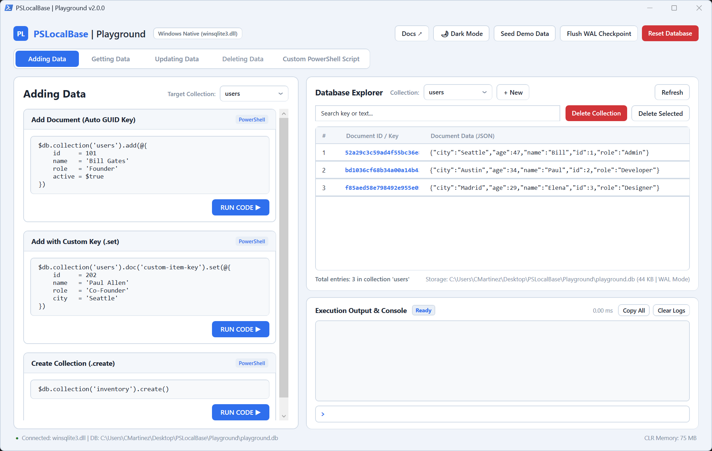

# PSLocalBase Playground

An interactive Windows desktop visual playground for **PSLocalBase** inspired by Danny Connell's Localbase Playground (from the JavaScript library) and built with a clean, modern Windows enterprise design system.

Features a modern dual-pane desktop workspace built entirely with native **PowerShell + WPF**:
* **Theme Engine (Dark & Light Mode):** 100% full Dark Mode and Light Mode support with 1-click live toggle (`🌙 Dark Mode` / `☀️ Light Mode`), auto-detection of Windows OS dark theme preference, and `-DarkMode` launch switch.
* **Modern Custom Dropdowns:** High-contrast custom ComboBox controls with SVG chevron indicators, hover glows, and rounded item styling.
* **Left Pane (Interactive Code Cards):** Interactive tutorial cards for **Adding Data**, **Getting Data**, **Updating Data**, **Deleting Data**, and **Custom PowerShell Script** with live editable code snippets, target collection synchronization, and `RUN CODE ▶` buttons.
* **Right Pane (Database Explorer & Execution Console):**
  * **Database Explorer:** Multi-collection inspector (`users`, `products`, `orders`), live DataGrid with `#`, `Document ID / Key`, and formatted JSON payloads, real-time search by key or text value, and double-click document inspection.
  * **Execution Console:** Real-time log stream showing formatted JSON representations, execution timestamps, status badges, and sub-millisecond execution times.
  * **Live CLI Prompt:** Type any ad-hoc `$db` expression at the bottom `>` prompt and press <kbd>Enter</kbd> to execute immediately!
* **Full Path Display:** The footer status bar and storage metrics explicitly display the canonical full path to the active SQLite database file.

---

## Visual Tour & Theme Engine

PSLocalBase Playground includes an integrated, zero-dependency dual-theme engine conforming to modern Windows 11 enterprise design guidelines.

### Dark Mode (Enterprise High-Contrast)

Default dark aesthetic built with deep slate canvas (`#121418`), rich surface cards (`#1C1F26`), crisp borders (`#2C313A`), and vibrant cobalt accents (`#3B82F6`):


### Light Mode (Clean Daylight Workspace)

Daylight theme optimized for high-readability environments with cool blue-gray canvas (`#F0F4FA`), pure white cards (`#FFFFFF`), subtle borders (`#D0DAE6`), and classic royal blue accents (`#2F6FED`):



## Security Model

The code cards and the `>` prompt execute whatever PowerShell you enter, with your Windows permissions and full access to `$db`. The Playground is a local developer tool, not a sandbox: do not paste untrusted code into it or expose it to other users.

---

## Quick Launch

From PowerShell 7+ or Windows PowerShell 5.1:

```powershell
# Launch in default theme (auto-detects Windows dark mode):
pwsh -ExecutionPolicy Bypass -File .\Playground\Playground.ps1

# Launch explicitly in Dark Mode:
pwsh -File .\Playground\Playground.ps1 -DarkMode

# Windows PowerShell 5.1:
powershell.exe -ExecutionPolicy Bypass -File .\Playground\Playground.ps1
```

---

## Features

1. **Enterprise Design System & Theme Engine:**
   * **Full Dark Mode:** Rich dark theme (`#121418` canvas, `#1C1F26` surface cards, `#2C313A` borders, `#3B82F6` accents).
   * **Clean Light Mode:** Crisp enterprise light theme (`#F0F4FA` canvas, `#FFFFFF` cards, `#D0DAE6` borders, `#2F6FED` accents).
   * **Instant Theme Switching:** Toggle between Light and Dark mode without restarting the application via the top-right theme button.
   * **Custom Dropdown Styling:** Clean ComboBox with custom SVG chevron arrow, high-contrast text, and hover item animations.

2. **Interactive Database Operations:**
   * **Adding Data:** Test `.add()` (auto-GUID), `.set()` (custom key) directly against the active collection, and `.create()` for explicit collection table creation.
   * **Getting Data:** Test `.get()`, `.where()`, `.orderBy()`, and `.limit()`.
   * **Updating Data:** Test `.update()` recursive deep merge and `.set()` complete document replacement.
   * **Deleting Data:** Test single document deletion, collection purging via `.delete()`, `.drop()`, and `.collectionExists()` checks.
   * **Custom PowerShell:** An open script editor with full access to `$db` for custom pipelines, filters, and loops.

3. **Database Explorer:**
   * **Collection Switcher:** Instant switching between `users`, `products`, `orders`, or newly created collections.
   * **Live Search Filter:** High-speed filter by document key or any substring inside the document JSON.
   * **Double-Click Inspection:** Double-click any row in the DataGrid to inspect its full JSON payload in the console.
   * **Toolbar Actions:** Seed Demo Data (with overwrite safety confirmation), Flush WAL Checkpoint (`PRAGMA wal_checkpoint(TRUNCATE)`), Refresh, `+ New` Collection modal dialog, Delete Collection, and Delete Selected Document.

4. **Execution Output & Console:**
   * **Real-Time Logging:** Color-coded execution badges (`Success` in forest green, `Error` in crimson) with execution duration in milliseconds.
   * **Text Wrapping & Formatting:** Clean, multi-line wrapped JSON viewer in Consolas font.
   * **Ad-Hoc REPL Input:** Execute commands directly at the `>` prompt.

5. **Zero Dependencies & Native Integration:**
   * 100% native Windows: Runs directly on Windows `winsqlite3.dll` without any external NuGet packages, binaries, or C++ runtimes.
   * Compatible across both Windows PowerShell 5.1 and PowerShell 7+.

---

## Automated Verification

To run automated headless verification of all UI elements, XAML controls, theme switching, and database operations:

```powershell
pwsh -ExecutionPolicy Bypass -File .\Playground\verify-playground.ps1
# or
powershell.exe -ExecutionPolicy Bypass -File .\Playground\verify-playground.ps1
```

CI runs this verification in both PowerShell 7 and Windows PowerShell 5.1.
