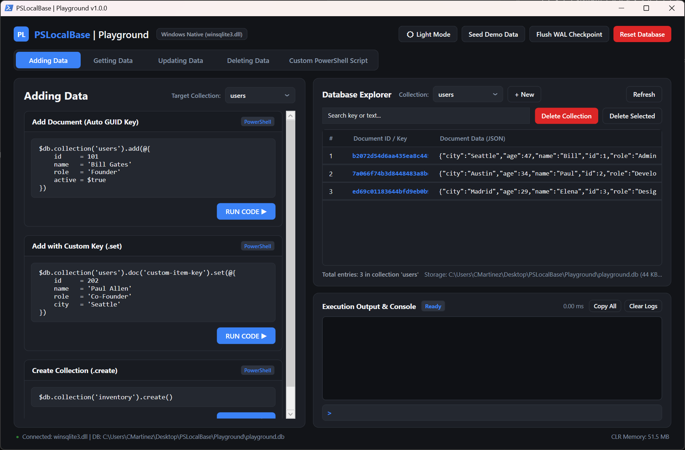
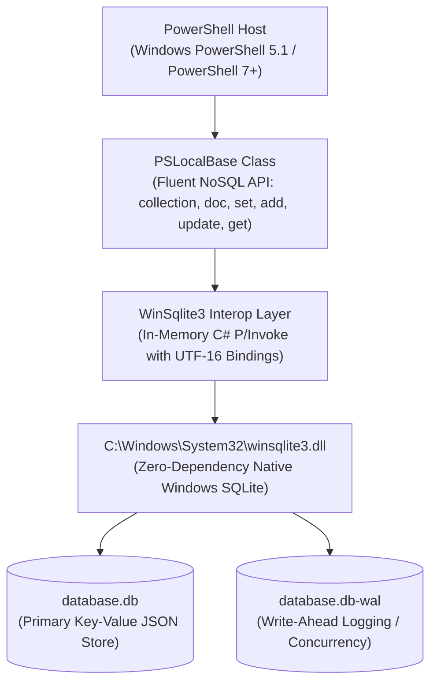

# PSLocalBase

[](https://microsoft.com/powershell)
[](https://github.com/PowerShell/PowerShell)
[](#zero-dependencies-guarantee)
[](LICENSE)

> **PSLocalBase** is a lightweight, zero-dependency embedded document (NoSQL / Key-Value) database engine for PowerShell, inspired by the JavaScript library [Localbase](https://github.com/samuk190/localbase).<br>
>
> Under the hood, it operates as a native NoSQL Document Store built on top of Windows' pre-installed SQLite engine (`winsqlite3.dll`) using its built-in JSON functions. It incurs zero overhead by running in-memory P/Invoke directly in C, returns native PowerShell objects (`[PSCustomObject]`) with seamless dot-notation access, and provides full support for arrays and nested document structures.<br>
>
> 📖 **Full Documentation:** For step-by-step walkthroughs, full code examples, and advanced usage, see the [Full Documentation (_DOCS/)](_DOCS/).

---

## Table of Contents

- [Zero Dependencies Guarantee](#zero-dependencies-guarantee)
- [System Requirements & Compatibility](#system-requirements--compatibility)
- [Interactive GUI Playground (WPF)](#interactive-gui-playground-wpf)
- [Quick Start](#quick-start)
- [Core API Reference](#core-api-reference)
  - [Initialization](#initialization)
  - [Collections & Documents](#collections--documents)
  - [Writing Data (`set`, `add`, `update`)](#writing-data-set-add-update)
  - [Atomic Array Mutations (`ArrayUnion`, `ArrayRemove`)](#atomic-array-mutations-arrayunion-arrayremove)
  - [Secondary Expression Indexes (`createIndex`, `dropIndex`)](#secondary-expression-indexes-createindex-dropindex)
  - [Querying & Filtering (`get`, `where`, `orderBy`, `limit`, `query`)](#querying--filtering-get-where-orderby-limit-query)
  - [Relational Lookups (`populate`)](#relational-lookups-populate)
  - [Compound Queries & Sharding (`union`, `unionAll`, `collectionGroup`)](#compound-queries--sharding-union-unionall-collectiongroup)
  - [Deleting Data (`drop`, `delete`, `deleteDatabase`)](#deleting-data-drop-delete-deletedatabase)
  - [ACID Transactions](#acid-transactions)
  - [Resource Cleanup & Disposal](#resource-cleanup--disposal)
  - [Production Best Practices & Crash Resilience](#production-best-practices--crash-resilience)
- [Test Suite & Quality Verification](#test-suite--quality-verification)
  - [Independent Security & Quality Audit (Claude Opus 5.5)](#independent-security--quality-audit-claude-opus-55)
- [Architecture & Performance](#architecture--performance)
- [Full Documentation](_DOCS/)

- [Technical Specification](_DOCS/SPECIFICATION.md)
- [Security Policy](SECURITY.md)

---

## Interactive GUI Playground (WPF)

Explore, query, test, and inspect your database visually in a single self-contained WPF application:



```powershell
# Launch the interactive GUI Playground (PowerShell 7+ or Windows PowerShell 5.1):
pwsh -ExecutionPolicy Bypass -File .\Playground\Playground.ps1
# or
powershell.exe -ExecutionPolicy Bypass -File .\Playground\Playground.ps1
```

Supports 1-click **Dark Mode** & **Light Mode**, live multi-collection DataGrid inspection, interactive code tutorial cards, and an integrated execution console. For full details and Light Mode preview, see the [Playground Documentation](Playground/README.md).


---

## Zero Dependencies Guarantee

- **No External Packages:** No NuGet packages, no PowerShell Gallery modules (`System.Data.SQLite`, `Microsoft.Data.Sqlite`), and no third-party binary downloads required.
- **Native OS Engine:** Interacts with the native Windows library `C:\Windows\System32\winsqlite3.dll` using dynamic C# and P/Invoke compiled at runtime via `Add-Type`.
- **Pure Unicode UTF-16:** Guaranteed non-corrupt storage and retrieval of special characters, accents, nested quotes, and multi-byte emojis (🚀🔥).

---

## System Requirements & Compatibility

### Platform Support Matrix

| Tier | Operating System / Environment | Testing & Support Status |
| :--- | :--- | :--- |
| **Verified in CI & Local Suites** | Windows 10 / 11 (x64) | Tested on GitHub Actions (`windows-latest`) and local workstations across PowerShell 7.x (Core) and Windows PowerShell 5.1 (Desktop). |
| **Supported by Design** | Windows Server 2019, 2022, 2025 (x64); WinPE x64 | Supported by design via native System32 `winsqlite3.dll` and .NET Framework 4.5+ / .NET Core runtime. |
| **Unverified / Architectural Bounds** | ARM64 architectures, UNC / SMB shares | ARM64 is not currently verified in CI. Remote network shares (`\\server\share`) are explicitly blocked by design for WAL database persistence. |

- **CI Test Suite:** Continuous integration executes the complete multi-suite test runner (`_TESTS/run-tests.ps1`, 122+ test cases) on both PowerShell 7 and Windows PowerShell 5.1 on every commit.
- **Engine Dependency:** Relies strictly on Microsoft's native `C:\Windows\System32\winsqlite3.dll`, pre-installed on modern Windows installations.

---

## Quick Start

```powershell
# 1. Import the module
Import-Module .\PSLocalBase.psd1 -Force

# 2. Initialize database (disk file or in-memory) with optional configuration:
$db = [PSLocalBase]::new(".\my_database.db", @{
    wal         = $true   # Enable Write-Ahead Logging (default: $true)
    cacheSizeMB = 32      # SQLite memory cache in MB (default: 16)
    busyTimeout = 5000    # Lock retry timeout in ms (default: 5000)
    depth       = 20      # Max JSON serialization depth (default: 20)
})

# 3. Insert documents
$db.collection("users").doc("usr-100").set(@{
    name   = "Carlos Martinez"
    role   = "Admin"
    active = $true
    skills = @("PowerShell", "SQLite", "Cloud")
})

# 4. Read back single document
$user = $db.collection("users").doc("usr-100").get()
Write-Host "Name: $($user.name) | Role: $($user.role) | Active: $($user.active)"

# 5. Query collection with filtering and ordering
$admins = $db.collection("users").where("role", "=", "Admin").orderBy("name", "asc").get()
$admins | Format-Table name, role, active

# 6. Clean close
$db.close()
```

> 💡 For comprehensive step-by-step guides, pagination, bulk operations, and deep merge updates, see the [Full Documentation (`_DOCS/`)](_DOCS/).

---

## Core API Reference

### Initialization

#### Standard File-Based Database
```powershell
$db = [PSLocalBase]::new("C:\Data\app.db")
# Or using the helper cmdlet:
$db = New-LocalBase -Path "C:\Data\app.db"
```
* Automatically creates parent directories if they do not exist.
* Configures Write-Ahead Logging (`WAL`) mode, `synchronous = NORMAL`, and a 5000ms `busy_timeout`.

#### In-Memory Database
```powershell
$db = [PSLocalBase]::new(":memory:")
# Or:
$db = New-LocalBase
```

---

### Collections & Documents

#### `collection([string]$name)`
Navigates to a collection (SQLite table). Alphanumeric characters and underscores (`^[a-zA-Z0-9_]+$`) are supported. Navigation is **lazy**: referencing a collection does not create empty/ghost tables in SQLite until documents are written, preventing unintentional table creation on typos or read queries.
```powershell
$db.collection("orders")
```

#### `create()` / `createCollection([string]$name)`
Explicitly provisions the collection table in SQLite immediately without requiring initial documents, matching the counterpart `.delete()` lifecycle method.
```powershell
# Fluent chaining:
$db.collection("audit_logs").create()

# Direct method:
$db.createCollection("audit_logs")
```

#### `collectionExists([string]$name)`
Checks whether a collection table already exists in the database.
```powershell
if (-not $db.collectionExists("users")) {
    $db.createCollection("users")
}
```

#### `doc([object]$keyOrCriteria)`
Targets a specific document by its key or an object/hashtable criteria. If the collection does not yet exist, targeting with `.doc()` (or creating with `.add()`) automatically provisions the collection table in SQLite.
```powershell
# By string key
$db.collection("orders").doc("ord-001")

# By hashtable / criteria object
$db.collection("orders").doc(@{ id = "ord-001" })
```

#### `getCollections()` / `listCollections()`
Retrieves an array of all collection names present in the database.
```powershell
$collections = $db.getCollections()
# Returns: @("orders", "users", "products")
```

---

### Writing Data (`set`, `add`, `update`)

#### `set([object]$data, [hashtable]$options)`
* **On a Document:** Overwrites or creates the targeted document.
  ```powershell
  $db.collection("products").doc("p1").set(@{
      name  = "Mechanical Keyboard"
      price = 120.00
      stock = 45
  })
  ```
* **On a Collection:** Overwrites the entire collection atomically with an array of objects.
  ```powershell
  $items = @(
      @{ id = "1"; name = "Item One" },
      @{ id = "2"; name = "Item Two" }
  )
  $db.collection("products").set($items)
  ```

#### `add([object]$data, [string]$customKey = "")`
Generates a unique 32-character GUID (or uses `$customKey` if supplied), saves the document, and returns the key.
```powershell
$genKey = $db.collection("audit_logs").add(@{
    action    = "UserLogin"
    timestamp = (Get-Date).ToString("o")
})
Write-Host "Generated audit record key: $genKey"
```

#### `update([object]$partialData)`
Performs a deep, recursive merge into the existing document. Unspecified fields remain untouched.
```powershell
$db.collection("users").doc("usr-100").update(@{
    profile = @{
        avatarUrl = "https://example.com/avatar.png"
    }
})
```

> 💡 **Looking for `upsert()` or storage schema validation?** See the [Full Documentation (`_DOCS/`)](_DOCS/#3-collections--document-lifecycle) for single-statement atomic upserts (`.upsert()`) and schema integrity checks (`.validate()`).

---

### Atomic Array Mutations (`ArrayUnion`, `ArrayRemove`)

Modify arrays inside documents atomically and idempotently without having to read-modify-write the full document.

#### `[PSLocalBase]::ArrayUnion([object[]]$values)`
Adds elements to an array only if they are not already present (set union).
```powershell
# Add tags/roles without duplicates using static method
$db.collection("users").doc("usr-100").update(@{
    roles = [PSLocalBase]::ArrayUnion("Editor", "Admin")
})

# Or using descriptor hashtable syntax
$db.collection("users").doc("usr-100").update(@{
    roles = @{ '$arrayUnion' = @("Editor", "Admin") }
})
```

#### `[PSLocalBase]::ArrayRemove([object[]]$values)`
Removes all occurrences of specified elements from an array.
```powershell
# Remove roles using static method
$db.collection("users").doc("usr-100").update(@{
    roles = [PSLocalBase]::ArrayRemove("Guest", "Editor")
})

# Or using descriptor hashtable syntax
$db.collection("users").doc("usr-100").update(@{
    roles = @{ '$arrayRemove' = @("Guest") }
})
```

---

### Secondary Expression Indexes (`createIndex`, `dropIndex`)

Speed up high-volume JSON lookups or enforce data integrity (like unique emails or usernames) using SQLite JSON1 expression indexes.

#### `createIndex([string]$field, [hashtable]$options)`
Creates a B-Tree index on a JSON field. Supports `unique = $true` and `order = "asc"|"desc"`.
```powershell
# Create unique index on email
$db.collection("users").createIndex("email", @{ unique = $true })

# Create descending index on timestamp
$db.collection("orders").createIndex("createdAt", @{ order = "desc" })
```

#### `dropIndex([string]$field)`
Drops the secondary index associated with the specified JSON field.
```powershell
$db.collection("users").dropIndex("email")
```

---

### Querying & Filtering (`get`, `where`, `orderBy`, `limit`, `query`)

#### `where([string]$field, [string]$operator, [object]$value)`
Filters documents using SQLite's native `json_extract` and `json_each`. Conditions can be chained together.

Supported Operators:
- Equality: `=`, `==`, `-eq`
- Inequality: `!=`, `<>`, `-ne`
- Comparisons: `>`, `<`, `>=`, `<=`, `-gt`, `-lt`, `-ge`, `-le`
- Pattern Matching: `LIKE`, `-like`, `NOT LIKE`, `-notlike`
- Membership: `IN`, `-in`
- Array Membership: `array-contains`, `-contains` (matches if document array contains the scalar value)
- Array Intersection: `array-contains-any` (matches if document array contains ANY of the given values)
- Exclusion: `not-in`, `-notin` (matches if field is not in the set, with null safety)

```powershell
# Boolean filter
$activeUsers = $db.collection("users").where("active", "=", $true).get()

# Number comparison
$expensive = $db.collection("products").where("price", ">=", 100).get()

# IN operator
$filtered = $db.collection("users").where("role", "IN", @("Admin", "Manager")).get()

# Array contains (checks if array property contains 'powershell')
$tagMatch = $db.collection("articles").where("tags", "array-contains", "powershell").get()

# Array contains any (checks if tags intersect with any given category)
$multiTag = $db.collection("articles").where("tags", "array-contains-any", @("devops", "cloud")).get()

# Not-In filter (null safe)
$nonFruit = $db.collection("products").where("category", "not-in", @("fruit", "dairy")).get()

# Multiple chained filters (AND)
$result = $db.collection("products") `
    .where("category", "=", "Electronics") `
    .where("price", "<", 500) `
    .get()
```

#### `orderBy([string]$field, [string]$direction = "asc")`
Sorts the query results by a JSON field. Accepts `"asc"` or `"desc"`.
```powershell
$sorted = $db.collection("products").orderBy("price", "desc").get()
```

#### `limit([int]$count)`
Restricts the maximum number of documents returned.
```powershell
$top3 = $db.collection("products").orderBy("price", "desc").limit(3).get()
```

#### `skip([int]$offset)`
Skips the specified number of records for offset-based pagination.
```powershell
# Page 2 (skip first 10, return next 10)
$page2 = $db.collection("products").orderBy("price", "asc").skip(10).limit(10).get()
```

#### `count()`
Returns the total count of documents in the collection or matching `.where()` filters directly in SQL without loading rows into memory.
```powershell
# Total count in collection
$total = $db.collection("users").count()

# Filtered count
$activeAdmins = $db.collection("users").where("active", "=", $true).where("role", "=", "Admin").count()
```

#### `get([hashtable]$options)`
Executes the query and returns data deserialized as `[PSCustomObject]`.
```powershell
# Standard retrieval (array of PSCustomObjects)
$docs = $db.collection("users").get()

# With document keys exposed (Localbase syntax)
$itemsWithKeys = $db.collection("users").get(@{ keys = $true })
foreach ($item in $itemsWithKeys) {
    Write-Host "Key: $($item.key) | User: $($item.data.name)"
}
```

#### Cross-Collection Queries & Custom SQL (`query`)
Perform relational `JOIN`s, aggregations (`COUNT`, `SUM`), or complex multi-table queries across independent collections:
```powershell
$sql = @'
SELECT 
    json_extract(u.doc, '$.name') AS Customer,
    json_extract(u.doc, '$.department') AS Department,
    json_extract(o.doc, '$.item') AS ItemPurchased,
    CAST(json_extract(o.doc, '$.price') AS REAL) AS Amount
FROM orders o
INNER JOIN users u ON json_extract(o.doc, '$.userId') = u.key
ORDER BY Amount DESC;
'@

$report = $db.query($sql)
$report | Format-Table -AutoSize

# Parameterized queries with strongly-typed binding and parameter count parity
$activeUsers = $db.query("SELECT key, json_extract(doc, '$.role') AS role FROM users WHERE json_extract(doc, '$.age') >= ?;", @(30))
```

> 💡 **Advanced Query Operators & Aggregations:** For selective field projections (`.select()`), first-item retrieval (`.first()`), instant boolean verification (`.exists()`), unique values (`.distinct()`), numeric aggregations (`.sum()`, `.avg()`, `.min()`, `.max()`), and array/type queries (`whereLength()`, `whereType()`), see the [Full Documentation (`_DOCS/`)](_DOCS/#4-querying--filtering).

---

### Relational Lookups (`populate`)

Embed referenced documents from other collections directly into the retrieved document using SQL `LEFT JOIN` and SQLite JSON nesting, with zero N+1 query penalty and full null-safety.

```powershell
# Populate 'customerId' reference with document from 'users' collection into property 'customer'
$order = $db.collection("orders").doc("ord-001").populate("customerId", "users", "customer").get()
Write-Host "Order amount: $($order.amount) | Customer: $($order.customer.name)"

# Populate during collection queries with orderBy/limit
$orders = $db.collection("orders") `
    .populate("customerId", @{ from = "users"; as = "customer" }) `
    .orderBy("amount", "desc") `
    .limit(10) `
    .get()
```

---

### Compound Queries & Sharding (`union`, `unionAll`, `collectionGroup`)

Combine query results across different collections or query sharded collections matching a pattern.

#### `.union($otherQuery)` and `.unionAll($otherQuery)`
Merges results of two queries directly in SQL. `union` deduplicates identical records; `unionAll` keeps all records for maximum throughput.
```powershell
$qNorth = $db.collection("users_north").where("active", "==", $true)
$qSouth = $db.collection("users_south").where("active", "==", $true)

# Deduplicated union of both regions
$allUsers = $qNorth.union($qSouth).get()

# Fast union preserving duplicates
$allUsersWithDups = $qNorth.unionAll($qSouth).get()

# Total count across union
$totalActive = $qNorth.union($qSouth).count()
```

#### `.collectionGroup([string]$pattern)`
Queries across multiple collections matching a wildcard pattern (e.g. date-sharded collections or category tables). Each returned document automatically includes a `._collection` property indicating its origin table.
```powershell
# Search all monthly log collections for critical errors
$errors = $db.collectionGroup("logs_2026_*") `
    .where("level", "==", "ERROR") `
    .orderBy("timestamp", "desc") `
    .limit(25) `
    .get()

foreach ($err in $errors) {
    Write-Host "[$($err._collection)] $($err.timestamp): $($err.message)"
}
```

---

### Deleting Data (`drop`, `delete`, `deleteDatabase`)

#### Deleting a Document
```powershell
$db.collection("users").doc("usr-100").delete()
```

#### Deleting Filtered Documents
```powershell
$db.collection("logs").where("level", "=", "DEBUG").delete()
```

#### Dropping vs Truncating a Collection Table
```powershell
# Drop the collection table cleanly (removes table schema and secondary indexes from sqlite_master)
$db.collection("temporary_data").drop()

# Or truncate all records from a collection (DELETE FROM [col], preserving schema and indexes)
$db.collection("temporary_data").delete()
```
> [!NOTE]
> * **Accidental data loss protection:** Calling `.delete()` with pagination (`.limit()`, `.skip()`) is rejected with an `InvalidOperationException` to guarantee targeted deletions never unintentionally purge an entire collection.
> * **Collection-level `deleteDatabase()` guard:** `.deleteDatabase()` must be invoked on the root `$db` instance (`$db.deleteDatabase()`). Invoking it on a child collection (`$col.deleteDatabase()`) is explicitly rejected with `InvalidOperationException` to prevent Windows file-lock conflicts.

#### Deleting the Entire Database File
Closes all connections and safely deletes the database file, along with any active `.db-wal` and `.db-shm` files:
```powershell
# Must be executed on the root instance:
$db.deleteDatabase()
```

---

### ACID Transactions

Wrap multi-document operations in high-performance atomic transactions:
```powershell
$db.beginTransaction()
try {
    $db.collection("accounts").doc("acc-1").update(@{ balance = 400 })
    $db.collection("accounts").doc("acc-2").update(@{ balance = 600 })
    $db.commit()
} catch {
    $db.rollback()
    throw
}
```

---

### Resource Cleanup & Disposal

#### `close()`
Releases native unmanaged handles immediately so disk files can be safely moved, backed up, or removed without file lock issues.
```powershell
$db.close()
```

#### `Dispose()`
Implements `System.IDisposable` for deterministic cleanup.

---

### Production Best Practices & Crash Resilience

#### Guaranteed Cleanup with `try / finally`

When writing production scripts, background jobs, or automation pipelines, always encapsulate database operations in a `try / finally` block. The `finally` block is guaranteed by PowerShell to execute even if an unhandled error or exception aborts the script, ensuring disk file locks are released instantly:

```powershell
Import-Module .\PSLocalBase.psd1

$db = [PSLocalBase]::new(".\production.db")
try {
    # Business logic here
    $db.collection("sales").add(@{
        amount = 1500
        date   = (Get-Date).ToString("o")
    })
    
    # Even if an unexpected error occurs here, finally will run!
    # throw "Unexpected network or processing failure"
} finally {
    # Guaranteed cleanup: ensures connection closure and unlocks files
    $db.close()
}
```

#### What Happens if a Script Crashes Without Calling `.close()`?

* **Data Integrity & Zero Corruption:** PSLocalBase operates in SQLite's Write-Ahead Logging (`WAL`) mode with full ACID compliance and `synchronous = NORMAL`. If a PowerShell process or script crashes mid-execution, uncommitted transactions are cleanly discarded upon recovery. With `synchronous = NORMAL`, SQLite syncs the WAL file during checkpoints, providing optimal write throughput while completely protecting against process crashes (for systems requiring strict power-loss durability across sudden physical outages, `synchronous = FULL` is available via configuration options).
* **Process Exit Cleanup:** When a PowerShell process terminates (e.g. running via `powershell -File script.ps1`, GitHub Actions, or Windows Scheduled Tasks), the Windows kernel automatically reclaims all unmanaged handles and closes all file descriptors.
* **Interactive Sessions:** If a script fails inside an interactive session (VS Code or PowerShell console), the handle remains bound to that session's variable until closed. Simply invoke `$db.close()` or close the terminal window to release the file lock.

#### Multi-Client Reading Over Network Shares (SMB)

* **Why Direct SMB Access is Blocked:** SQLite WAL mode relies on shared memory (`.db-shm`), which cannot coordinate across separate machines over SMB. Direct UNC and mapped paths are rejected to prevent file corruption.
* **Writer Snapshot Export (`VACUUM INTO`):** To share data over SMB without downtime, the writer process exports a consistent snapshot via `$db.query("VACUUM INTO 'snapshot.db';")` and publishes the completed file to the share.
* **Client Consumption (Local Temp):** Readers copy the published snapshot to a unique `$env:TEMP` path and query at full local NVMe speed with zero network lock contention. See [Section 11 in Full Documentation](_DOCS/#11-reading-over-smb--network-shares).
---

## Test Suite & Quality Verification

PSLocalBase includes a fully automated test suite located in `_TESTS/PSLocalBase.Tests.ps1` covering 83 comprehensive acceptance test cases and 10 specialized suites (161 automated validations) (100% PASS on both Windows PowerShell 5.1 and PowerShell 7+).

### Running the Tests
```powershell
# In Windows PowerShell 5.1
powershell -ExecutionPolicy Bypass -File .\_TESTS\run-tests.ps1

# In PowerShell 7+ (Core)
pwsh -ExecutionPolicy Bypass -File .\_TESTS\run-tests.ps1
```

For the complete breakdown of all 83 verified acceptance criteria, test categories, and validations, see the [Test Suite Documentation](_TESTS/README.md).

### Independent Security & Quality Audit (Claude Opus 5.5)

PSLocalBase was independently audited by **Claude Opus 5.5** (Commit: `c57b52c`, dev branch), receiving a **94/100 (Production Ready - Approved without reservations)** rating:

| Category | Score | Status |
|---|:---:|:---:|
| **Security** | **95/100** | ✅ Excellent (0 critical / 0 high vulnerabilities) |
| **Code Quality** | **93/100** | ✅ Excellent |
| **Functionality** | **96/100** | ✅ Excellent |
| **Architecture** | **94/100** | ✅ Excellent |
| **Documentation** | **92/100** | ✅ Excellent |
| **Test Coverage** | **91/100** | ✅ Excellent |
| **Overall Score** | **94/100** | ✅ **Production Ready** |

---

## Architecture & Performance



### Native SQLite 3 & NoSQL Architecture Highlights

#### 1. Embedded NoSQL Document Model
* **Dedicated Collection Tables:** Every collection is an isolated table structured as `(key TEXT PRIMARY KEY, doc TEXT)`.
* **Zero-Schema Overhead:** Documents are stored as standard JSON payloads, allowing arbitrary schema evolution without migrations.
* **Instant Key Access:** Single document queries (`.doc("id").get()`) leverage SQLite's B-Tree primary key index for $O(1)$ / $O(\log N)$ sub-millisecond retrieval.

#### 2. SQLite JSON1 Engine (`json_extract`)
* **Pushdown Query Execution:** Filters created with `.where()` evaluate properties inside the SQLite engine via `json_extract(doc, '$.field')`, completely bypassing the overhead of deserializing unneeded rows into PowerShell memory.
* **Deep Path Resolution:** Full support for nested properties (e.g. `.where("billing.address.city", "=", "Miami")` translates to `$.billing.address.city`).
* **Direct JSON Sorting:** `.orderBy("price", "desc")` executes in native C via `ORDER BY json_extract(...)`.
* **Type-Aware Evaluations:** Translates PowerShell booleans (`$true`/`$false`) to SQLite JSON integer representations (`1`/`0`), supports SQL `IN` array operators, string `LIKE` wildcards, and `NULL` checks.

#### 3. Native Concurrency & PRAGMA Tuning
* **`PRAGMA journal_mode = WAL;`** Activates Write-Ahead Logging. Readers never block writers, and writers never block readers across processes.
* **`PRAGMA synchronous = NORMAL;`** Optimizes I/O throughput by eliminating redundant disk sync flushes while maintaining complete ACID crash-safety.
* **`PRAGMA busy_timeout = 5000;`** Automatically waits up to 5,000 milliseconds when multiple threads or processes write concurrently, avoiding `SQLITE_BUSY` errors.
* **`PRAGMA cache_size = -16000;`** Reserves a 16 MB in-memory page cache for high-throughput query execution.

#### 4. Low-Level C UTF-16 Interoperability
* Interacts directly with `C:\Windows\System32\winsqlite3.dll` via UTF-16 APIs (`sqlite3_open16`, `sqlite3_prepare16_v2`, `sqlite3_bind_text16`, `sqlite3_column_text16`, `sqlite3_errmsg16`).
* 100% immune to ANSI/UTF-8 conversion data corruption or multi-byte emoji truncation.
* Fully parameterized SQL queries prevent SQL injection attacks.

---

## Author

Created and maintained by **Carlos Martinez** ([@cmartineztech](https://github.com/cmartineztech)).

---

## License

This project is licensed under the [MIT License](LICENSE) - see the [LICENSE](LICENSE) file for details.
