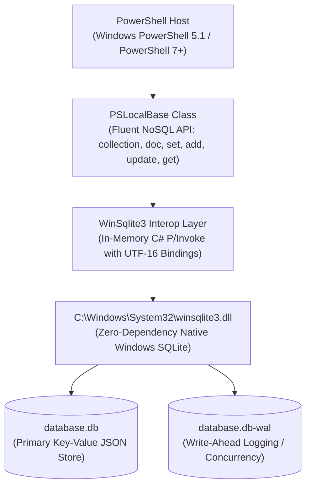

# PSLocalBase

[](https://microsoft.com/powershell)
[](https://github.com/PowerShell/PowerShell)
[](#zero-dependencies-guarantee)
[](LICENSE)

> **PSLocalBase** is a lightweight, zero-dependency embedded document (NoSQL / Key-Value) database engine for PowerShell, inspired by the JavaScript library [Localbase](https://github.com/samuk190/localbase).<br>
>
> Under the hood, it operates as a native NoSQL Document Store built on top of Windows' pre-installed SQLite engine (`winsqlite3.dll`) using its built-in JSON functions. It incurs zero overhead by running in-memory P/Invoke directly in C, returns native PowerShell objects (`[PSCustomObject]`) with seamless dot-notation access, and provides full support for arrays and nested document structures.

---

## Table of Contents

- [Zero Dependencies Guarantee](#zero-dependencies-guarantee)
- [System Requirements & Compatibility](#system-requirements--compatibility)
- [Interactive GUI Playground (WPF)](#interactive-gui-playground-wpf)
- [Quick Start](#quick-start)
- [Core API Reference](#core-api-reference)
  - [Initialization](#initialization)
  - [Collections & Documents](#collections--documents)
  - [Writing Data (`set`, `add`, `update`)](#writing-data-set-add-update)
  - [Querying & Filtering (`get`, `where`, `orderBy`, `limit`, `query`)](#querying--filtering-get-where-orderby-limit-query)
  - [Deleting Data (`delete`, `deleteDatabase`)](#deleting-data-delete-deletedatabase)
  - [ACID Transactions](#acid-transactions)
  - [Resource Cleanup & Disposal](#resource-cleanup--disposal)
  - [Production Best Practices & Crash Resilience](#production-best-practices--crash-resilience)
- [Test Suite & Quality Verification](#test-suite--quality-verification)
- [Architecture & Performance](#architecture--performance)
- [Quick Start Guide](_DOCS/QUICKSTART.md)
- [Technical Specification](_DOCS/SPECIFICATION.md)
- [Security Policy](SECURITY.md)

---

## Interactive GUI Playground (WPF)

Explore, query, test, and inspect your database visually in a single self-contained WPF application:

```powershell
# Launch the interactive GUI Playground (PowerShell 7+ or Windows PowerShell 5.1):
pwsh -ExecutionPolicy Bypass -File .\Playground\Playground.ps1
# or
powershell.exe -ExecutionPolicy Bypass -File .\Playground\Playground.ps1
```

For full details and walkthroughs, see the [Playground Documentation](Playground/README.md).


---

## Zero Dependencies Guarantee

- **No External Packages:** No NuGet packages, no PowerShell Gallery modules (`System.Data.SQLite`, `Microsoft.Data.Sqlite`), and no third-party binary downloads required.
- **Native OS Engine:** Interacts with the native Windows library `C:\Windows\System32\winsqlite3.dll` using dynamic C# and P/Invoke compiled at runtime via `Add-Type`.
- **Pure Unicode UTF-16:** Guaranteed non-corrupt storage and retrieval of special characters, accents, nested quotes, and multi-byte emojis (🚀🔥).

---

## System Requirements & Compatibility

| Requirement | Supported Environments |
| :--- | :--- |
| **Operating System** | Windows 10 (Build 1809+), Windows 11 (all editions), Windows Server 2019+, Windows PE x64 (with `WinPE-NetFX` and native `winsqlite3.dll`) |
| **PowerShell Editions** | Windows PowerShell 5.1 (Desktop / .NET Framework 4.x), PowerShell 7.x+ (Core / .NET 6+) |
| **Processor Architectures** | x64 and ARM64 (utilizing the native OS bitness of `winsqlite3.dll`) |

---

## Quick Start

```powershell
# 1. Import the module
Import-Module .\PSLocalBase.psd1 -Force

# 2. Initialize database (disk file or in-memory)
$db = [PSLocalBase]::new(".\my_database.db")

# 3. Insert documents
$db.collection("users").doc("usr-100").set(@{
    name   = "Carlos Martinez"
    role   = "Admin"
    active = $true
    skills = @("PowerShell", "SQLite", "Cloud")
})

# 4. Read back single document
$user = $db.collection("users").doc("usr-100").get()
Write-Host "Name: $($user.name) | Role: $($user.role) | Active: $($user.active)"

# 5. Query collection with filtering and ordering
$admins = $db.collection("users").where("role", "=", "Admin").orderBy("name", "asc").get()
$admins | Format-Table name, role, active

# 6. Clean close
$db.close()
```

---

## Core API Reference

### Initialization

#### Standard File-Based Database
```powershell
$db = [PSLocalBase]::new("C:\Data\app.db")
# Or using the helper cmdlet:
$db = New-LocalBase -Path "C:\Data\app.db"
```
* Automatically creates parent directories if they do not exist.
* Configures Write-Ahead Logging (`WAL`) mode, `synchronous = NORMAL`, and a 5000ms `busy_timeout`.

#### In-Memory Database
```powershell
$db = [PSLocalBase]::new(":memory:")
# Or:
$db = New-LocalBase
```

---

### Collections & Documents

#### `collection([string]$name)`
Navigates to a collection (SQLite table). Alphanumeric characters and underscores (`^[a-zA-Z0-9_]+$`) are supported. Navigation is **lazy**: referencing a collection does not create empty/ghost tables in SQLite until documents are written, preventing unintentional table creation on typos or read queries.
```powershell
$db.collection("orders")
```

#### `create()` / `createCollection([string]$name)`
Explicitly provisions the collection table in SQLite immediately without requiring initial documents, matching the counterpart `.delete()` lifecycle method.
```powershell
# Fluent chaining:
$db.collection("audit_logs").create()

# Direct method:
$db.createCollection("audit_logs")
```

#### `collectionExists([string]$name)`
Checks whether a collection table already exists in the database.
```powershell
if (-not $db.collectionExists("users")) {
    $db.createCollection("users")
}
```

#### `doc([object]$keyOrCriteria)`
Targets a specific document by its key or an object/hashtable criteria.
```powershell
# By string key
$db.collection("orders").doc("ord-001")

# By hashtable / criteria object
$db.collection("orders").doc(@{ id = "ord-001" })
```

#### `getCollections()` / `listCollections()`
Retrieves an array of all collection names present in the database.
```powershell
$collections = $db.getCollections()
# Returns: @("orders", "users", "products")
```

---

### Writing Data (`set`, `add`, `update`)

#### `set([object]$data, [hashtable]$options)`
* **On a Document:** Overwrites or creates the targeted document.
  ```powershell
  $db.collection("products").doc("p1").set(@{
      name  = "Mechanical Keyboard"
      price = 120.00
      stock = 45
  })
  ```
* **On a Collection:** Overwrites the entire collection atomically with an array of objects.
  ```powershell
  $items = @(
      @{ id = "1"; name = "Item One" },
      @{ id = "2"; name = "Item Two" }
  )
  $db.collection("products").set($items)
  ```

#### `add([object]$data, [string]$customKey = "")`
Generates a unique 32-character GUID (or uses `$customKey` if supplied), saves the document, and returns the key.
```powershell
$genKey = $db.collection("audit_logs").add(@{
    action    = "UserLogin"
    timestamp = (Get-Date).ToString("o")
})
Write-Host "Generated audit record key: $genKey"
```

#### `update([object]$partialData)`
Performs a deep, recursive merge into the existing document. Unspecified fields remain untouched.
```powershell
$db.collection("users").doc("usr-100").update(@{
    profile = @{
        avatarUrl = "https://example.com/avatar.png"
    }
})
```

---

### Querying & Filtering (`get`, `where`, `orderBy`, `limit`)

#### `where([string]$field, [string]$operator, [object]$value)`
Filters documents using SQLite's native `json_extract`. Conditions can be chained together.

Supported Operators:
- Equality: `=`, `==`, `-eq`
- Inequality: `!=`, `<>`, `-ne`
- Comparisons: `>`, `<`, `>=`, `<=`, `-gt`, `-lt`, `-ge`, `-le`
- Pattern Matching: `LIKE`, `-like`, `NOT LIKE`, `-notlike`
- Membership: `IN`, `-in`

```powershell
# Boolean filter
$activeUsers = $db.collection("users").where("active", "=", $true).get()

# Number comparison
$expensive = $db.collection("products").where("price", ">=", 100).get()

# IN operator
$filtered = $db.collection("users").where("role", "IN", @("Admin", "Manager")).get()

# Multiple chained filters (AND)
$result = $db.collection("products") `
    .where("category", "=", "Electronics") `
    .where("price", "<", 500) `
    .get()
```

#### `orderBy([string]$field, [string]$direction = "asc")`
Sorts the query results by a JSON field. Accepts `"asc"` or `"desc"`.
```powershell
$sorted = $db.collection("products").orderBy("price", "desc").get()
```

#### `limit([int]$count)`
Restricts the maximum number of documents returned.
```powershell
$top3 = $db.collection("products").orderBy("price", "desc").limit(3).get()
```

#### `skip([int]$offset)`
Skips the specified number of records for offset-based pagination.
```powershell
# Page 2 (skip first 10, return next 10)
$page2 = $db.collection("products").orderBy("price", "asc").skip(10).limit(10).get()
```

#### `count()`
Returns the total count of documents in the collection or matching `.where()` filters directly in SQL without loading rows into memory.
```powershell
# Total count in collection
$total = $db.collection("users").count()

# Filtered count
$activeAdmins = $db.collection("users").where("active", "=", $true).where("role", "=", "Admin").count()
```

#### `get([hashtable]$options)`
Executes the query and returns data deserialized as `[PSCustomObject]`.
```powershell
# Standard retrieval (array of PSCustomObjects)
$docs = $db.collection("users").get()

# With document keys exposed (Localbase syntax)
$itemsWithKeys = $db.collection("users").get(@{ keys = $true })
foreach ($item in $itemsWithKeys) {
    Write-Host "Key: $($item.key) | User: $($item.data.name)"
}
```

#### Cross-Collection Queries & Custom SQL (`query`)
Perform relational `JOIN`s, aggregations (`COUNT`, `SUM`), or complex multi-table queries across independent collections:
```powershell
$sql = @'
SELECT 
    json_extract(u.doc, '$.name') AS Customer,
    json_extract(u.doc, '$.department') AS Department,
    json_extract(o.doc, '$.item') AS ItemPurchased,
    CAST(json_extract(o.doc, '$.price') AS REAL) AS Amount
FROM orders o
INNER JOIN users u ON json_extract(o.doc, '$.userId') = u.key
ORDER BY Amount DESC;
'@

$report = $db.query($sql)
$report | Format-Table -AutoSize
```

---

### Deleting Data (`delete`, `deleteDatabase`)

#### Deleting a Document
```powershell
$db.collection("users").doc("usr-100").delete()
```

#### Deleting Filtered Documents
```powershell
$db.collection("logs").where("level", "=", "DEBUG").delete()
```

#### Deleting an Entire Collection
```powershell
$db.collection("temporary_data").delete()
```

#### Deleting the Entire Database File
Closes all connections and safely deletes the database file, along with any active `.db-wal` and `.db-shm` files:
```powershell
$db.deleteDatabase()
```

---

### ACID Transactions

Wrap multi-document operations in high-performance atomic transactions:
```powershell
$db.beginTransaction()
try {
    $db.collection("accounts").doc("acc-1").update(@{ balance = 400 })
    $db.collection("accounts").doc("acc-2").update(@{ balance = 600 })
    $db.commit()
} catch {
    $db.rollback()
    throw
}
```

---

### Resource Cleanup & Disposal

#### `close()`
Releases native unmanaged handles immediately so disk files can be safely moved, backed up, or removed without file lock issues.
```powershell
$db.close()
```

#### `Dispose()`
Implements `System.IDisposable` for deterministic cleanup.

---

### Production Best Practices & Crash Resilience

#### Guaranteed Cleanup with `try / finally`

When writing production scripts, background jobs, or automation pipelines, always encapsulate database operations in a `try / finally` block. The `finally` block is guaranteed by PowerShell to execute even if an unhandled error or exception aborts the script, ensuring disk file locks are released instantly:

```powershell
Import-Module .\PSLocalBase.psd1

$db = [PSLocalBase]::new(".\production.db")
try {
    # Business logic here
    $db.collection("sales").add(@{
        amount = 1500
        date   = (Get-Date).ToString("o")
    })
    
    # Even if an unexpected error occurs here, finally will run!
    # throw "Unexpected network or processing failure"
} finally {
    # Guaranteed cleanup: ensures connection closure and unlocks files
    $db.close()
}
```

#### What Happens if a Script Crashes Without Calling `.close()`?

* **Data Integrity & Zero Corruption:** PSLocalBase operates in SQLite's Write-Ahead Logging (`WAL`) mode with full ACID compliance. If a script crashes mid-execution, any uncommitted transaction is safely discarded by the engine. The database file will **never** be corrupted.
* **Process Exit Cleanup:** When a PowerShell process terminates (e.g. running via `powershell -File script.ps1`, GitHub Actions, or Windows Scheduled Tasks), the Windows kernel automatically reclaims all unmanaged handles and closes all file descriptors.
* **Interactive Sessions:** If a script fails inside an interactive session (VS Code or PowerShell console), the handle remains bound to that session's variable until closed. Simply invoke `$db.close()` or close the terminal window to release the file lock.

---

## Test Suite & Quality Verification

PSLocalBase includes a fully automated test suite located in `_TESTS/PSLocalBase.Tests.ps1` covering 27 comprehensive test cases (100% PASS on both Windows PowerShell 5.1 and PowerShell 7+).

### Running the Tests
```powershell
# In Windows PowerShell 5.1
powershell -ExecutionPolicy Bypass -File .\_TESTS\run-tests.ps1

# In PowerShell 7+ (Core)
pwsh -ExecutionPolicy Bypass -File .\_TESTS\run-tests.ps1
```

For the complete breakdown of all 27 verified acceptance criteria, test categories, and validations, see the [Test Suite Documentation](_TESTS/README.md).

---

## Architecture & Performance



### Native SQLite 3 & NoSQL Architecture Highlights

#### 1. Embedded NoSQL Document Model
* **Dedicated Collection Tables:** Every collection is an isolated table structured as `(key TEXT PRIMARY KEY, doc TEXT)`.
* **Zero-Schema Overhead:** Documents are stored as standard JSON payloads, allowing arbitrary schema evolution without migrations.
* **Instant Key Access:** Single document queries (`.doc("id").get()`) leverage SQLite's B-Tree primary key index for $O(1)$ / $O(\log N)$ sub-millisecond retrieval.

#### 2. SQLite JSON1 Engine (`json_extract`)
* **Pushdown Query Execution:** Filters created with `.where()` evaluate properties inside the SQLite engine via `json_extract(doc, '$.field')`, completely bypassing the overhead of deserializing unneeded rows into PowerShell memory.
* **Deep Path Resolution:** Full support for nested properties (e.g. `.where("billing.address.city", "=", "Miami")` translates to `$.billing.address.city`).
* **Direct JSON Sorting:** `.orderBy("price", "desc")` executes in native C via `ORDER BY json_extract(...)`.
* **Type-Aware Evaluations:** Translates PowerShell booleans (`$true`/`$false`) to SQLite JSON integer representations (`1`/`0`), supports SQL `IN` array operators, string `LIKE` wildcards, and `NULL` checks.

#### 3. Native Concurrency & PRAGMA Tuning
* **`PRAGMA journal_mode = WAL;`** Activates Write-Ahead Logging. Readers never block writers, and writers never block readers across processes.
* **`PRAGMA synchronous = NORMAL;`** Optimizes I/O throughput by eliminating redundant disk sync flushes while maintaining complete ACID crash-safety.
* **`PRAGMA busy_timeout = 5000;`** Automatically waits up to 5,000 milliseconds when multiple threads or processes write concurrently, avoiding `SQLITE_BUSY` errors.
* **`PRAGMA cache_size = -16000;`** Reserves a 16 MB in-memory page cache for high-throughput query execution.

#### 4. Low-Level C UTF-16 Interoperability
* Interacts directly with `C:\Windows\System32\winsqlite3.dll` via UTF-16 APIs (`sqlite3_open16`, `sqlite3_prepare16_v2`, `sqlite3_bind_text16`, `sqlite3_column_text16`, `sqlite3_errmsg16`).
* 100% immune to ANSI/UTF-8 conversion data corruption or multi-byte emoji truncation.
* Fully parameterized SQL queries prevent SQL injection attacks.

---

## Author

Created and maintained by **Carlos Martinez** ([@cmartineztech](https://github.com/cmartineztech)).

---

## License

This project is licensed under the [MIT License](LICENSE) - see the [LICENSE](LICENSE) file for details.
