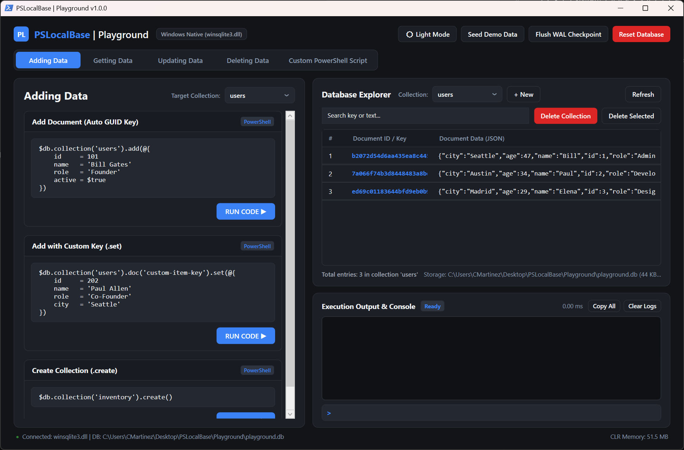
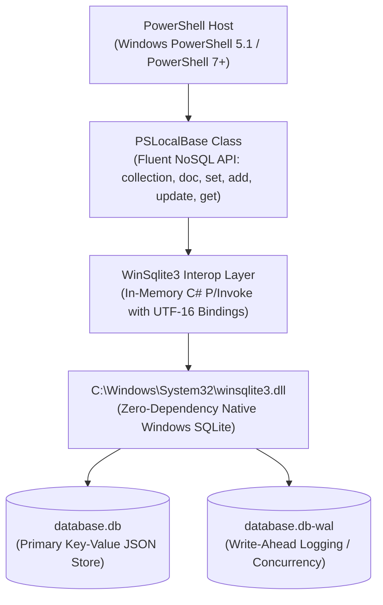

# PSLocalBase

[](https://www.powershellgallery.com/packages/PSLocalBase)
[](https://www.powershellgallery.com/packages/PSLocalBase)
[](https://microsoft.com/powershell)
[](https://github.com/PowerShell/PowerShell)
[](#zero-dependencies-guarantee)
[](LICENSE)

> **PSLocalBase** is a local JSON document database for PowerShell—not just a SQLite wrapper. Store, query, and pipe documents as native PowerShell objects, making structured data in automation easier to manage than hand-maintained JSON or CSV files.
>
> It uses Windows' built-in SQLite engine (`winsqlite3.dll`) and its JSON functions under the hood, with no external dependencies. Documents can include arrays and nested structures.
>
> 📖 **Full Documentation:** For step-by-step walkthroughs, full code examples, and advanced usage, see the [Full Documentation (_DOCS/)](_DOCS/).

---

## Table of Contents

- [Installation & Getting Started](#installation--getting-started)
  - [Option A: Install from PowerShell Gallery](#option-a-install-from-powershell-gallery-recommended)
  - [Option B: Run from Source Code](#option-b-run-from-source-code-development--local-clone)
- [Zero Dependencies Guarantee](#zero-dependencies-guarantee)
- [System Requirements & Compatibility](#system-requirements--compatibility)
- [Interactive GUI Playground (WPF)](#interactive-gui-playground-wpf)
- [Quick Start](#quick-start)
- [Native PowerShell Cmdlets & Pipeline](#native-cmdlets)
- [Core API Reference](#core-api-reference)
  - [Initialization](#initialization)
  - [Collections & Documents](#collections--documents)
  - [Writing Data (`set`, `add`, `update`)](#writing-data-set-add-update)
  - [Atomic Array Mutations (`ArrayUnion`, `ArrayRemove`)](#atomic-array-mutations-arrayunion-arrayremove)
  - [Secondary Expression Indexes (`createIndex`, `dropIndex`)](#secondary-expression-indexes-createindex-dropindex)
  - [Querying & Filtering (`get`, `where`, `orderBy`, `limit`, `query`)](#querying--filtering-get-where-orderby-limit-query)
  - [Relational Lookups (`populate`)](#relational-lookups-populate)
  - [Compound Queries & Sharding (`union`, `unionAll`, `collectionGroup`)](#compound-queries--sharding-union-unionall-collectiongroup)
  - [Deleting Data (`drop`, `delete`, `deleteDatabase`)](#deleting-data-drop-delete-deletedatabase)
  - [ACID Transactions](#acid-transactions)
  - [Resource Cleanup & Disposal](#resource-cleanup--disposal)
  - [Production Best Practices & Crash Resilience](#production-best-practices--crash-resilience)
- [Test Suite & Quality Verification](#test-suite--quality-verification)
  - [Independent Security & Quality Audit](#independent-security--quality-audit-multi-agent-evaluations)
- [Architecture & Performance](#architecture--performance)
- [Full Documentation](_DOCS/)
- [Technical Specification](_DOCS/SPECIFICATION.md)
- [Security Policy](SECURITY.md)
- [Changelog](CHANGELOG.md)

---

## Interactive GUI Playground (WPF)

Explore, query, test, and inspect your database visually in a single self-contained WPF application:




```powershell
# Launch the interactive GUI Playground (PowerShell 7+ or Windows PowerShell 5.1):
pwsh -ExecutionPolicy Bypass -File .\Playground\Playground.ps1
# or
powershell.exe -ExecutionPolicy Bypass -File .\Playground\Playground.ps1
```

Supports 1-click **Dark Mode** & **Light Mode**, live multi-collection DataGrid inspection, interactive code tutorial cards, and an integrated execution console. The console runs any PowerShell you type with your own permissions; it is a local developer tool, not a sandbox. See the [Playground Documentation](Playground/README.md).

> [!NOTE]
> **Repository Companion Tool:** The Playground GUI is maintained in this GitHub repository as a visual development tool. The PowerShell Gallery package (`Install-Module PSLocalBase`) distributes the pure, lightweight database engine without GUI overhead. When `PSLocalBase` is installed on your machine, `Playground.ps1` runs directly out of the box.


---

## Zero Dependencies Guarantee

- **No External Packages:** No NuGet packages, no PowerShell Gallery modules (`System.Data.SQLite`, `Microsoft.Data.Sqlite`), and no third-party binary downloads required.
- **Native OS Engine:** Interacts with the native Windows library `C:\Windows\System32\winsqlite3.dll` using dynamic C# and P/Invoke compiled at runtime via `Add-Type`.
- **Unicode UTF-16:** Native text bindings preserve special characters, accents, nested quotes, embedded NULs, and emojis (🚀🔥).

---

## System Requirements & Compatibility

### Platform Support Matrix

| Tier | Operating System / Environment | Testing & Support Status |
| :--- | :--- | :--- |
| **Automated validation** | Windows x64 & Windows ARM64 | GitHub Actions matrix runs in parallel on `windows-latest` (x64) and `windows-11-arm` (native ARM64); suites cover PowerShell 7.x (Core) and Windows PowerShell 5.1 (Desktop) in both architectures. |
| **Requires environment validation** | Windows Server 2019, 2022, 2025 (x64); WinPE x64 | Requires a compatible native `winsqlite3.dll` with the JSON functions used by the module, plus a working PowerShell/.NET environment. |
| **Architectural Bounds** | UNC / SMB shares, Non-Windows OS | Remote network shares (`\\server\share`) are explicitly blocked by design for WAL database persistence. Linux/macOS are unsupported due to the native Windows `winsqlite3.dll` dependency. |

- **Windows only:** "PowerShell 7+" means PowerShell 7 on Windows. Importing on Linux or macOS throws `PlatformNotSupportedException`.
- **CI Test Suite:** Continuous integration validates the manifest, runs PSScriptAnalyzer, executes the 22-suite test runner (`_TESTS/run-tests.ps1`) on both PowerShell 7 and Windows PowerShell 5.1, and verifies the Playground in both editions on every push and pull request.
- **Engine Dependency:** Relies strictly on Microsoft's native `C:\Windows\System32\winsqlite3.dll`, pre-installed on modern Windows installations.

---

## Installation & Getting Started

### Option A: Install from PowerShell Gallery (Recommended)

PSLocalBase is published as an official module on the [PowerShell Gallery](https://www.powershellgallery.com/packages/PSLocalBase). Install and import it in PowerShell 7+ or Windows PowerShell 5.1:

```powershell
# Install for current user (no admin rights required):
Install-Module -Name PSLocalBase -Scope CurrentUser

# Or install for all users (requires Administrator privileges):
Install-Module -Name PSLocalBase -Scope AllUsers

# Import the module:
Import-Module PSLocalBase
```

To update to future versions:
```powershell
Update-Module -Name PSLocalBase
```

---

### Option B: Run from Source Code (Development / Local Clone)

If you are developing, customizing the engine, running tests, or launching the visual Playground from the repository:

```powershell
# 1. Clone the repository:
git clone https://github.com/cmartineztech/PSLocalBase.git
cd PSLocalBase

# 2. Import directly from the local manifest:
Import-Module .\PSLocalBase.psd1 -Force

# 3. (Optional) Run the complete 22-suite test runner:
.\_TESTS\run-tests.ps1

# 4. (Optional) Launch the visual GUI Playground:
pwsh -ExecutionPolicy Bypass -File .\Playground\Playground.ps1
```

---

## Quick Start

```powershell
# 1. Install & import from PowerShell Gallery (or from source):
Install-Module -Name PSLocalBase -Scope CurrentUser
Import-Module PSLocalBase
# Or from cloned source: Import-Module .\PSLocalBase.psd1 -Force

# 2. Initialize database (disk file or in-memory) with optional configuration:
$db = [PSLocalBase]::new(".\my_database.db", @{
    wal         = $true   # Enable Write-Ahead Logging (default: $true)
    cacheSizeMB = 32      # SQLite memory cache in MB (default: 16)
    busyTimeout = 5000    # Lock retry timeout in ms (default: 5000)
    depth       = 20      # Max JSON serialization depth (default: 20)
})

# 3. Insert documents
$db.collection("users").doc("usr-100").set(@{
    name   = "Carlos Martinez"
    role   = "Admin"
    active = $true
    skills = @("PowerShell", "SQLite", "Cloud")
})

# 4. Read back single document
$user = $db.collection("users").doc("usr-100").get()
Write-Host "Name: $($user.name) | Role: $($user.role) | Active: $($user.active)"

# 5. Query collection with filtering and ordering
$admins = $db.collection("users").where("role", "=", "Admin").orderBy("name", "asc").get()
$admins | Format-Table name, role, active

# 6. Clean close
$db.close()
```

> 💡 For comprehensive step-by-step guides, pagination, bulk operations, and deep merge updates, see the [Full Documentation (`_DOCS/`)](_DOCS/).

---

## Core API Reference

### Initialization

#### Standard File-Based Database
```powershell
$db = [PSLocalBase]::new("C:\Data\app.db")
# Or using the helper cmdlet, optionally with configuration:
$db = New-LocalBase -Path "C:\Data\app.db" -Options @{ busyTimeout = 10000; cacheSizeMB = 32 }
```
* Automatically creates parent directories if they do not exist.
* Configures Write-Ahead Logging (`WAL`) mode, `synchronous = NORMAL`, and a 5000ms `busy_timeout`.
* Opens with `PRAGMA trusted_schema = OFF`, so triggers and views stored in a database file cannot call unsafe functions.

| Option | Default | Meaning |
| :--- | :--- | :--- |
| `wal` | `$true` | Write-Ahead Logging. Accepts booleans or `true`/`false`/`1`/`0`/`yes`/`no`; anything else throws. |
| `synchronous` | `NORMAL` (WAL) / `FULL` | `EXTRA`, `FULL`, `NORMAL`, `OFF` or `0`-`3`. |
| `busyTimeout` | `5000` | Milliseconds to wait for a lock held by another connection. |
| `cacheSizeMB` | `16` | SQLite page cache size. |
| `depth` | `20` | Maximum nesting when writing documents (1-100, validated at construction). |
| `maxDocumentBytes` | `16MB` | Maximum serialized JSON size in UTF-16 bytes (`json.Length * 2`), enforced before writes and on reads. Errors name only the key. |
| `maxReadDepth` | `100` | Maximum JSON object/array nesting, enforced before writes and on reads. Errors name only the key. |
| `debug` | `$false` | Prints SQL text (never bound values) and includes SQL in error messages. |

A closed instance cannot be reopened; create a new one.

#### In-Memory Database
```powershell
$db = [PSLocalBase]::new(":memory:")
# Or:
$db = New-LocalBase
```

---

### Collections & Documents

#### `collection([string]$name)`
Navigates to a collection (SQLite table). Only alphanumeric characters and underscores (`\A[a-zA-Z0-9_]+\z`) are accepted. Navigation is **lazy**: referencing a collection does not create empty/ghost tables in SQLite until documents are written, preventing unintentional table creation on typos or read queries.
```powershell
$db.collection("orders")
```

#### `create()` / `createCollection([string]$name)`
Explicitly provisions the collection table in SQLite immediately without requiring initial documents, matching the counterpart `.delete()` lifecycle method.
```powershell
# Fluent chaining:
$db.collection("audit_logs").create()

# Direct method:
$db.createCollection("audit_logs")
```

#### `collectionExists([string]$name)`
Checks whether a collection table already exists in the database.
```powershell
if (-not $db.collectionExists("users")) {
    $db.createCollection("users")
}
```

#### `doc([object]$keyOrCriteria)`
Targets a specific document by its key or by an object/hashtable that names it with a `key`, `id`, or `_key` property, in that precedence order. Other properties are ignored; criteria without an identity property are rejected. Targeting is lazy: the collection table is created by the first write (`set`, `add`, `upsert`, `update`), never by `.doc()` or a read.
```powershell
# By string key
$db.collection("orders").doc("ord-001")

# By hashtable / criteria object
$db.collection("orders").doc(@{ id = "ord-001" })
```

Queries are immutable: writing through a reference does not change it, so `$d = $db.collection("orders").doc("ord-001"); $d.set(...); $d.get()` still reads `ord-001`.

#### `getCollections()` / `listCollections()`
Retrieves an array of all collection names present in the database.
```powershell
$collections = $db.getCollections()
# Returns: @("orders", "users", "products")
```

---

### Writing Data (`set`, `add`, `update`)

#### `set([object]$data, [hashtable]$options)`
* **On a Document:** Overwrites or creates the targeted document.
  ```powershell
  $db.collection("products").doc("p1").set(@{
      name  = "Mechanical Keyboard"
      price = 120.00
      stock = 45
  })
  ```
* **On a Collection:** Replaces every document in the collection atomically with an array of objects. `replaceAll()` is the explicit name; `set(@(...))` is kept as an alias.
  ```powershell
  $items = @(
      @{ id = "1"; name = "Item One" },
      @{ id = "2"; name = "Item Two" }
  )
  $db.collection("products").replaceAll($items)
  ```
  Replacing is rejected with `InvalidOperationException` on a query that has `where()`, `orderBy()`, `limit()` or `skip()`, because it would delete documents outside the filter.

`DateTime` and `DateTimeOffset` values are stored as ISO-8601 UTC strings (for example `2026-01-02T03:04:05.0000000Z`) in both editions, and are converted the same way when used as filter or query parameters. Property names that are empty or differ only in case are rejected, since they cannot be read back.

#### `add([object]$data, [string]$customKey = "")`
Generates a unique 32-character GUID (or uses `$customKey` if supplied), saves the document, and returns the key.
```powershell
$genKey = $db.collection("audit_logs").add(@{
    action    = "UserLogin"
    timestamp = (Get-Date).ToString("o")
})
Write-Host "Generated audit record key: $genKey"
```

#### `update([object]$partialData)`
Performs a deep, recursive merge into the existing document. Unspecified fields remain untouched.
```powershell
$db.collection("users").doc("usr-100").update(@{
    profile = @{
        avatarUrl = "https://example.com/avatar.png"
    }
})
```

> 💡 **Looking for `upsert()` or storage schema validation?** See the [Full Documentation (`_DOCS/`)](_DOCS/#3-collections--document-lifecycle) for single-statement atomic upserts (`.upsert()`) and schema integrity checks (`.validate()`).

---

### Atomic Array Mutations (`ArrayUnion`, `ArrayRemove`)

Modify arrays inside documents without implementing the read/merge/write yourself. `update()` reads, merges, and rewrites the document inside a transaction; array union/remove operations are idempotent.

#### `[PSLocalBase]::ArrayUnion([object[]]$values)`
Adds elements to an array only if they are not already present (set union).
```powershell
# Add tags/roles without duplicates using static method
$db.collection("users").doc("usr-100").update(@{
    roles = [PSLocalBase]::ArrayUnion("Editor", "Admin")
})

# Or using descriptor hashtable syntax
$db.collection("users").doc("usr-100").update(@{
    roles = @{ '$arrayUnion' = @("Editor", "Admin") }
})
```

#### `[PSLocalBase]::ArrayRemove([object[]]$values)`
Removes all occurrences of specified elements from an array.
```powershell
# Remove roles using static method
$db.collection("users").doc("usr-100").update(@{
    roles = [PSLocalBase]::ArrayRemove("Guest", "Editor")
})

# Or using descriptor hashtable syntax
$db.collection("users").doc("usr-100").update(@{
    roles = @{ '$arrayRemove' = @("Guest") }
})
```

---

### Secondary Expression Indexes (`createIndex`, `dropIndex`)

Enforce uniqueness (such as unique emails or usernames) using SQLite JSON expression indexes. Compatible raw SQL can use them for lookups; current fluent queries wrap JSON extraction with a numeric guard and generally cannot use these indexes for filtering or sorting. See the [index tradeoff](_DOCS/SPECIFICATION.md#numeric-comparison-domain).

#### `createIndex([string]$field, [hashtable]$options)`
Creates a B-Tree index on a JSON field. Supports `unique = $true` and `order = "asc"|"desc"`.
```powershell
# Create unique index on email
$db.collection("users").createIndex("email", @{ unique = $true })

# Create descending index on timestamp
$db.collection("orders").createIndex("createdAt", @{ order = "desc" })
```

#### `dropIndex([string]$field)`
Drops the secondary index associated with the specified JSON field.
```powershell
$db.collection("users").dropIndex("email")
```

---

### Querying & Filtering (`get`, `where`, `orderBy`, `limit`, `query`)

#### `where([string]$field, [string]$operator, [object]$value)`
Filters documents using SQLite's native `json_extract` and `json_each`. Conditions can be chained together.

Supported Operators:
- Equality: `=`, `==`, `-eq`
- Inequality: `!=`, `<>`, `-ne`
- Comparisons: `>`, `<`, `>=`, `<=`, `-gt`, `-lt`, `-ge`, `-le`
- Pattern Matching: `LIKE`, `-like`, `NOT LIKE`, `-notlike`

`LIKE`/`NOT LIKE` use SQLite patterns. `-like`/`-notlike` use PowerShell's case-insensitive wildcard matcher inside a registered SQLite function, preserving complete strings including embedded NUL and Unicode. Bracket classes remain explicitly unsupported. Scalar null comparisons use SQLite JSON semantics: `.where("field", "=", $null)` matches both explicit JSON nulls and missing fields; `.where("field", "!=", $null)` matches only present, non-null values. `.whereType("field", "null")` matches explicit JSON nulls only, not missing fields. After upgrading the native bridge, start a fresh PowerShell session.
- Membership: `IN`, `-in` (a `$null` member also matches documents where the field is null or missing)
- Array Membership: `array-contains`, `-contains` (matches if document array contains the scalar value)
- Array Intersection: `array-contains-any` (matches if document array contains ANY of the given values)
- Exclusion: `not-in`, `-notin` (matches documents where the field is present, not null, and not in the set; `$null` members are ignored)
- Array length and JSON type: `length`, `length>`, ... and `type` (`null`, `integer`, `real`, `number`, `text`, `array`, `object`, `true`, `false`, `boolean`), also available as `whereLength()` and `whereType()`
- Field Existence: `exists`, `-exists`, `missing`, `-missing`. For `exists`, `$true` matches present fields (including explicit null) and `$false` matches missing fields; `missing` reverses this. Helpers `whereExists()` and `whereMissing()` express the positive tests.

```powershell
# Boolean filter
$activeUsers = $db.collection("users").where("active", "=", $true).get()

# Number comparison
$expensive = $db.collection("products").where("price", ">=", 100).get()

# IN operator
$filtered = $db.collection("users").where("role", "IN", @("Admin", "Manager")).get()

# Array contains (checks if array property contains 'powershell')
$tagMatch = $db.collection("articles").where("tags", "array-contains", "powershell").get()

# Array contains any (checks if tags intersect with any given category)
$multiTag = $db.collection("articles").where("tags", "array-contains-any", @("devops", "cloud")).get()

# Not-In filter (null safe)
$nonFruit = $db.collection("products").where("category", "not-in", @("fruit", "dairy")).get()

# Multiple chained filters (AND)
$result = $db.collection("products").
    where("category", "=", "Electronics").
    where("price", "<", 500).
    get()

# Field existence & missing checks
$unassigned = $db.collection("tasks").whereMissing("assignee").get()
$hasSettings = $db.collection("users").whereExists("profile.settings").get()
```

#### `orderBy([string]$field, [string]$direction = "asc")`
Sorts the query results by a JSON field. Accepts `"asc"` or `"desc"`.
```powershell
$sorted = $db.collection("products").orderBy("price", "desc").get()
```

#### `limit([int]$count)`
Restricts the maximum number of documents returned.
```powershell
$top3 = $db.collection("products").orderBy("price", "desc").limit(3).get()
```

#### `skip([int]$offset)`
Skips the specified number of records for offset-based pagination.
```powershell
# Page 2 (skip first 10, return next 10)
$page2 = $db.collection("products").orderBy("price", "asc").skip(10).limit(10).get()
```

#### `count()`
Returns the count matching the query, including its filters and `limit()`/`skip()` window, directly in SQL without loading documents into memory.
```powershell
# Total count in collection
$total = $db.collection("users").count()

# Filtered count
$activeAdmins = $db.collection("users").where("active", "=", $true).where("role", "=", "Admin").count()
```

#### `get([hashtable]$options)`
Executes the query and deserializes JSON. Object documents become `[PSCustomObject]`; arrays, scalars, and null retain their JSON value shape. A point lookup returns the document or `$null`; collection queries return an array.
```powershell
# Standard retrieval (array of PSCustomObjects)
$docs = $db.collection("users").get()

# With document keys exposed (Localbase syntax)
$itemsWithKeys = $db.collection("users").get(@{ keys = $true })
foreach ($item in $itemsWithKeys) {
    Write-Host "Key: $($item.key) | User: $($item.data.name)"
}
```

#### Cross-Collection Queries & Custom SQL (`query`)
Perform relational `JOIN`s, aggregations (`COUNT`, `SUM`), or complex multi-table queries across independent collections:
```powershell
$sql = @'
SELECT 
    json_extract(u.doc, '$.name') AS Customer,
    json_extract(u.doc, '$.department') AS Department,
    json_extract(o.doc, '$.item') AS ItemPurchased,
    CAST(json_extract(o.doc, '$.price') AS REAL) AS Amount
FROM orders o
INNER JOIN users u ON json_extract(o.doc, '$.userId') = u.key
ORDER BY Amount DESC;
'@

$report = $db.query($sql)
$report | Format-Table -AutoSize

# Parameterized queries with strongly-typed binding and parameter count parity
$activeUsers = $db.query("SELECT key, json_extract(doc, '$.role') AS role FROM users WHERE json_extract(doc, '$.age') >= ?;", @(30))
```

`query()` executes exactly one statement; text after the first `;` other than whitespace or comments is rejected. It is a trusted-code escape hatch: never build its SQL from user input, pass values through the parameter array.

> 💡 **Advanced Query Operators & Aggregations:** For selective field projections (`.select()`), first-item retrieval (`.first()`), existence checks (`.exists()`), unique values (`.distinct()`), numeric aggregations (`.sum()`, `.avg()`, `.min()`, `.max()`), and array/type/existence queries (`whereLength()`, `whereType()`, `whereExists()`, `whereMissing()`), see the [Full Documentation (`_DOCS/`)](_DOCS/#4-querying--filtering).

---

### Relational Lookups (`populate`)

Embed referenced documents from other collections directly into the retrieved document using SQL `LEFT JOIN` and SQLite JSON nesting, with zero N+1 query penalty and full null-safety.

```powershell
# Populate 'customerId' reference with document from 'users' collection into property 'customer'
$order = $db.collection("orders").doc("ord-001").populate("customerId", "users", "customer").get()
Write-Host "Order amount: $($order.amount) | Customer: $($order.customer.name)"

# Populate during collection queries with orderBy/limit
$orders = $db.collection("orders").
    populate("customerId", @{ from = "users"; as = "customer" }).
    orderBy("amount", "desc").
    limit(10).
    get()
```

---

### Compound Queries & Sharding (`union`, `unionAll`, `collectionGroup`)

Combine query results across different collections or query sharded collections matching a pattern.

#### `.union($otherQuery)` and `.unionAll($otherQuery)`
Merges results of two queries directly in SQL. `union` deduplicates identical `(key, doc)` SQL rows, so equal payloads with different keys remain separate; `unionAll` keeps all rows.

Modifiers before composition belong to their branch. Modifiers after `union()`/`unionAll()` apply once to the combined result. Both branch plans are captured independently; a branch's existing pagination or projection is not reused as global state.
```powershell
$qNorth = $db.collection("users_north").where("active", "==", $true)
$qSouth = $db.collection("users_south").where("active", "==", $true)

# Deduplicated union of both regions
$allUsers = $qNorth.union($qSouth).get()

# Fast union preserving duplicates
$allUsersWithDups = $qNorth.unionAll($qSouth).get()

# Total count across union
$totalActive = $qNorth.union($qSouth).count()
```

#### `.collectionGroup([string]$pattern)`
Queries across multiple collections matching a wildcard pattern (e.g. date-sharded collections or category tables). Matching tables are resolved each time the query runs. The returned view adds `._collection` indicating the origin table, replacing any stored property of that name; projections can omit it. It can also be used in `where()`. A collection group cannot be combined with `union()`/`unionAll()`.
```powershell
# Search all monthly log collections for critical errors
$errors = $db.collectionGroup("logs_2026_*").
    where("level", "==", "ERROR").
    orderBy("timestamp", "desc").
    limit(25).
    get()

foreach ($err in $errors) {
    Write-Host "[$($err._collection)] $($err.timestamp): $($err.message)"
}
```

---

### Deleting Data (`drop`, `delete`, `deleteDatabase`)

#### Deleting a Document
```powershell
$db.collection("users").doc("usr-100").delete()
```

#### Deleting Filtered Documents
```powershell
$db.collection("logs").where("level", "=", "DEBUG").delete()
```

#### Dropping vs Truncating a Collection Table
```powershell
# Drop the collection table cleanly (removes table schema and secondary indexes from sqlite_master)
$db.collection("temporary_data").drop()

# Or truncate all records from a collection (DELETE FROM [col], preserving schema and indexes)
$db.collection("temporary_data").delete()
```
> [!NOTE]
> * **Mutation modifiers:** Calling `.delete()` with `.orderBy()`, `.limit()`, or `.skip()` is rejected with an `InvalidOperationException`. An unfiltered collection `.delete()` explicitly removes every document.
> * **Collection-level `deleteDatabase()` guard:** `.deleteDatabase()` must be invoked on the root `$db` instance (`$db.deleteDatabase()`). Invoking it on a child collection (`$col.deleteDatabase()`) is explicitly rejected with `InvalidOperationException` to prevent Windows file-lock conflicts.

#### Deleting the Entire Database File
Closes this root connection (invalidating its child query references) and attempts to delete the database file and any `-wal`, `-shm` and `-journal` files. Independently opened connections are not closed; close those first. Deletion failures throw an `IOException`. The path is taken from SQLite itself:
```powershell
# Must be executed on the root instance:
$db.deleteDatabase()
```

---

### ACID Transactions

Wrap multi-document operations in high-performance atomic transactions:
```powershell
$db.beginTransaction()
try {
    $db.collection("accounts").doc("acc-1").update(@{ balance = 400 })
    $db.collection("accounts").doc("acc-2").update(@{ balance = 600 })
    $db.commit()
} catch {
    $db.rollback()
    throw
}
```

`beginTransaction()` issues `BEGIN IMMEDIATE`, taking the write lock up front so concurrent writers in other processes wait up to `busyTimeout` instead of failing on lock upgrade. Use `beginTransaction('deferred')` or `beginTransaction('exclusive')` for the other SQLite modes. If `COMMIT` fails, `InTransaction` stays `$true` so you can retry or roll back.

---

### Resource Cleanup & Disposal

#### `close()`
Releases native unmanaged handles immediately so disk files can be safely moved, backed up, or removed without file lock issues.
```powershell
$db.close()
```

#### `Dispose()`
Implements `System.IDisposable` for deterministic cleanup.

The native connection is owned by a `SafeHandle`, so an instance that is never closed is still released when the garbage collector finalizes it. Closing explicitly remains the way to release file locks at a known point.

---

### Production Best Practices & Crash Resilience

#### Guaranteed Cleanup with `try / finally`

When writing production scripts, background jobs, or automation pipelines, encapsulate database operations in a `try / finally` block. PowerShell runs `finally` during normal completion and exception unwinding so the connection is released promptly. Forced process termination or a machine outage can prevent the block from running.

```powershell
Import-Module .\PSLocalBase.psd1

$db = [PSLocalBase]::new(".\production.db")
try {
    # Business logic here
    $db.collection("sales").add(@{
        amount = 1500
        date   = (Get-Date).ToString("o")
    })
    
    # Even if an unexpected error occurs here, finally will run!
    # throw "Unexpected network or processing failure"
} finally {
    # Guaranteed cleanup: ensures connection closure and unlocks files
    $db.close()
}
```

#### What Happens if a Script Crashes Without Calling `.close()`?

* **Recovery and durability:** File databases default to WAL with `synchronous = NORMAL`. SQLite recovers interrupted transactions after a process crash. A script error in an interactive host can leave a live transaction open until rollback or close. `NORMAL` can lose recent committed transactions after a power outage; use `synchronous = FULL` when stronger commit durability is needed. Hardware, filesystem failures, and unsafe custom SQL can still compromise data; maintain backups.
* **Process Exit Cleanup:** When a PowerShell process terminates (e.g. running via `powershell -File script.ps1`, GitHub Actions, or Windows Scheduled Tasks), the Windows kernel automatically reclaims all unmanaged handles and closes all file descriptors.
* **Interactive Sessions:** If a script fails inside an interactive session (VS Code or PowerShell console), the handle stays open while a variable still references the instance. Invoke `$db.close()` to release the file lock immediately; unreferenced instances are closed by the finalizer.

#### Multi-Client Reading Over Network Shares (SMB)

* **Why Direct SMB Access is Blocked:** SQLite WAL mode relies on shared memory (`.db-shm`), which cannot coordinate across separate machines over SMB. Direct UNC and mapped paths are rejected to prevent file corruption.
* **Writer Snapshot Export (`VACUUM INTO`):** To share data over SMB without downtime, the writer process exports a consistent snapshot via `$db.query("VACUUM INTO 'snapshot.db';")` and publishes the completed file to the share.
* **Client Consumption (Local Temp):** Readers copy the published snapshot to a unique `$env:TEMP` path and query at full local NVMe speed with zero network lock contention. See [Section 11 in Full Documentation](_DOCS/#11-reading-over-smb--network-shares).

---

<a id="native-cmdlets"></a>

## 🛠️ Native PowerShell Cmdlets & Pipeline (DevOps Mode)

> [!NOTE]
> **Available in 2.1.0 and `main`:** Install from PowerShell Gallery or import the manifest from a clone of `main`. The package includes the cmdlet adapter.

Prefer idiomatic PowerShell cmdlets with pipeline integration (`|`), `-WhatIf`, `-Confirm`, and native `Get-Help`?

In addition to the primary Fluent API (`$db.collection().where().get()`), PSLocalBase exports **22 PowerShell advanced functions**. The adapter (`PSLocalBase.Cmdlets.ps1`) and Fluent API share the native SQLite engine through the C# interop bridge and can be mixed:

```powershell
# 1. Connect to session
Connect-LocalBase -Path "./infrastructure.db"

# 2. Ingest objects directly from PowerShell pipeline!
Get-Process | Select-Object -First 10 ProcessName, Id, CPU | 
    Add-LocalBaseDocument -Collection "processes"

# 3. Query documents with parameters or hashtable filters
$procs = Get-LocalBaseDocument -Collection "processes" -Filter @{ ProcessName = 'powershell' }

# 4. Pipeline chaining with safety (-WhatIf / -Confirm)
Get-LocalBaseDocument -Collection "processes" -Field "CPU" -Operator ">=" -Value 50 | 
    Remove-LocalBaseDocument -WhatIf

# 5. Fast mathematical aggregations
Measure-LocalBaseDocument -Collection "processes" -Field "CPU" -Average -Maximum

# 6. Disconnect
Disconnect-LocalBase
```

> 📖 **Full Cmdlets Documentation:** See [_DOCS/CMDLETS.md](_DOCS/CMDLETS.md) for all 22 cmdlets, parameter sets, installation, seven aliases (including `Open-LocalBase` and `Close-LocalBase`), and operational automation scripts. Connection, collection, and transaction cmdlets complement the document pipeline. Advanced fluent features such as `populate`, unions, collection groups, and custom SQL remain available through the connection object; cmdlet projections use `Get-LocalBaseDocument -Select`.

---

## Test Suite & Quality Verification

PSLocalBase includes an automated test runner, `_TESTS/run-tests.ps1`, that executes 22 suites, each in its own process: 84 core acceptance cases (TC-01 to TC-84), the native Cmdlets test suite, contracts regression checks, second-review hardening regressions, point-pagination and bridge-upgrade regressions, a seeded randomized comparison against a PowerShell model, native resource stress checks, and a multi-process WAL test in which Windows PowerShell 5.1 and PowerShell 7 write to the same file concurrently. All suites pass on both editions.

### Running the Tests
```powershell
# In Windows PowerShell 5.1
powershell -ExecutionPolicy Bypass -File .\_TESTS\run-tests.ps1

# In PowerShell 7+ (Core)
pwsh -ExecutionPolicy Bypass -File .\_TESTS\run-tests.ps1
```

For the complete breakdown of all 84 verified acceptance criteria, test categories, and validations, see the [Test Suite Documentation](_TESTS/README.md).

### Independent Security & Quality Audit (Multi-Agent Evaluations)

The [consolidated review table](_DOCS/CONSOLIDATED-REVIEW.md) is the single scorecard for the historical Gemini High and Sol reviews and the new six-area Sol Medium reassessment of the current `main` working copy. It records each baseline, scoring scope, findings and validation evidence. The new Antigravity reviews could not start because the provider failed to open its sessions; no new Antigravity scores are claimed.

The new Sol reviews found one low-severity constructor-options validation inconsistency and several minor documentation discrepancies, which were corrected afterward. Both full 22-suite runners, both Playground automation checks, manifest validation, static analysis and local package inspection passed. Scores are reviewer judgments rather than coverage percentages or certification. See the [historical release record](_DOCS/FINAL-VERIFICATION-REPORT-v2.md) for the earlier validation provenance.

---
## Architecture & Performance



### Native SQLite 3 & NoSQL Architecture Highlights

#### 1. Embedded NoSQL Document Model
* **Dedicated Collection Tables:** Every collection is an isolated table structured as `(key TEXT PRIMARY KEY, doc TEXT)`.
* **Zero-Schema Overhead:** Documents are stored as standard JSON payloads, allowing arbitrary schema evolution without migrations.
* **Indexed Key Access:** Single document queries (`.doc("id").get()`) use SQLite's B-Tree primary key index with $O(\log N)$ lookup; latency depends on workload and environment.

#### 2. SQLite JSON1 Engine (`json_extract`)
* **Pushdown Query Execution:** Filters created with `.where()` evaluate properties inside the SQLite engine via `json_extract(doc, '$.field')`, completely bypassing the overhead of deserializing unneeded rows into PowerShell memory.
* **Deep Path Resolution:** Full support for nested properties (e.g. `.where("billing.address.city", "=", "Miami")` translates to `$.billing.address.city`).
* **Direct JSON Sorting:** `.orderBy("price", "desc")` executes in native C via `ORDER BY json_extract(...)`.
* **Type-Aware Evaluations:** Translates PowerShell booleans (`$true`/`$false`) to SQLite JSON integer representations (`1`/`0`), supports SQL `IN` array operators, string `LIKE` wildcards, and `NULL` checks.

#### 3. Native Concurrency & PRAGMA Tuning
* **`PRAGMA journal_mode = WAL;`** Default for file databases, allowing readers alongside a writer. Writes remain serialized and operations can still encounter locks. `wal = $false` selects DELETE mode; in-memory databases use MEMORY mode.
* **`PRAGMA synchronous = NORMAL;`** Default with WAL; `FULL` is the default with `wal = $false`. See the durability limits above.
* **`PRAGMA busy_timeout = 5000;`** Default lock wait of up to 5,000 milliseconds; operations can still fail with `SQLITE_BUSY`.
* **`PRAGMA cache_size = -16384;`** Default page-cache target of 16 MiB, allocated as needed.

#### 4. Low-Level C UTF-16 Interoperability
* Interacts directly with `C:\Windows\System32\winsqlite3.dll` via UTF-16 APIs (`sqlite3_open16`, `sqlite3_prepare16_v2`, `sqlite3_bind_text16`, `sqlite3_column_text16`, `sqlite3_errmsg16`).
* Length-aware UTF-16 bindings preserve Unicode text and embedded NULs.
* Fluent values use bound parameters and identifiers are validated. Custom `query()` SQL remains trusted code; bind its values and never concatenate untrusted SQL fragments.

---

## Author

Created and maintained by **Carlos Martinez** ([@cmartineztech](https://github.com/cmartineztech)).

---

## License

This project is licensed under the [MIT License](LICENSE) - see the [LICENSE](LICENSE) file for details.

### Query precision and pipeline bounds

Numeric SQL operations reject unsupported stored numbers and parameters instead of silently rounding them into matches. Int64 integers are exact; supported reals use conservative binary64 semantics, not arbitrary decimal precision. See [numeric comparison limits and index tradeoffs](_DOCS/SPECIFICATION.md#numeric-comparison-domain).

Get materializes the selected result before pipeline output. Use `-First`/`-Skip` or fluent `limit`/`skip` for bounded reads; downstream `Select-Object -First` does not reduce reads. Array/scalar/null documents from Get use a `.Value` envelope that Set/Add unwrap using private identity. `distinct()` rejects pagination and ordering modifiers. See [cmdlet contracts](_DOCS/CMDLETS.md#second-review-contracts).
