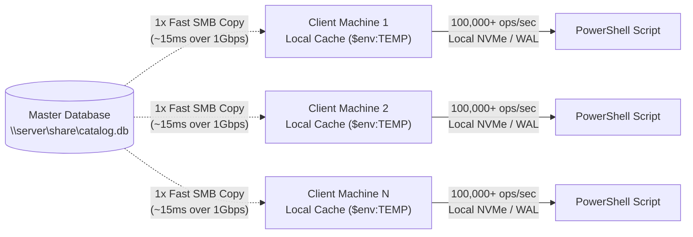

# PSLocalBase — Quick Start Guide

Welcome to the **PSLocalBase** Quick Start Guide! This document provides clear, copy-pasteable examples to get you up and running with embedded NoSQL document persistence in PowerShell in under two minutes.

---

## Table of Contents

- [Visual Explorer: Interactive GUI Playground](#visual-explorer-interactive-gui-playground)
- [1. Installation & Import](#1-installation--import)
- [2. Database Initialization](#2-database-initialization)
  - [File-Based Persistence](#file-based-persistence)
  - [In-Memory Ephemeral Database](#in-memory-ephemeral-database)
- [3. Working with Collections & Documents](#3-working-with-collections--documents)
  - [Explicit Collection Creation (`create`)](#explicit-collection-creation-create)
  - [Insert with Custom Key (`set`)](#insert-with-custom-key-set)
  - [Insert with Auto-Generated GUID (`add`)](#insert-with-auto-generated-guid-add)
  - [Atomic Upsert (`upsert`)](#atomic-upsert-upsert)
  - [Bulk Insert Entire Collection](#bulk-insert-entire-collection)
  - [Partial Update / Deep Merge (`update`)](#partial-update--deep-merge-update)
  - [Atomic Array Mutations (`ArrayUnion`, `ArrayRemove`)](#atomic-array-mutations-arrayunion-arrayremove)
  - [Secondary Expression Indexes (`createIndex`, `dropIndex`)](#secondary-expression-indexes-createindex-dropindex)
  - [Schema Validation & Health (`validate`)](#schema-validation--health-validate)
  - [Deleting Documents & Dropping Collections (`delete`, `drop`)](#deleting-documents--dropping-collections-delete-drop)
- [4. Querying & Filtering](#4-querying--filtering)
  - [Point Lookups](#point-lookups)
  - [Collection-Wide Retrieval](#collection-wide-retrieval)
  - [First Matching Record (`first`)](#first-matching-record-first)
  - [O(1) Existence Verification (`exists`)](#o1-existence-verification-exists)
  - [Selective Field Projection (`select`)](#selective-field-projection-select)
  - [Distinct Values (`distinct`)](#distinct-values-distinct)
  - [Filtering with `where()`](#filtering-with-where)
  - [Array Membership & Intersection (`array-contains`, `array-contains-any`)](#array-membership--intersection-array-contains-array-contains-any)
  - [Array Length Filtering (`whereLength`, `length`)](#array-length-filtering-wherelength-length)
  - [Data Type Filtering (`whereType`, `type`)](#data-type-filtering-wheretype-type)
  - [Array Index Filtering](#array-index-filtering)
  - [Counting Records (`count`)](#counting-records-count)
  - [Mathematical Aggregations (`sum`, `avg`, `min`, `max`)](#mathematical-aggregations-sum-avg-min-max)
  - [Sorting & Pagination (`orderBy`, `skip`, `limit`)](#sorting--pagination-orderby-skip-limit)
  - [Exposing Primary Keys (`keys = $true`)](#exposing-primary-keys-keys--true)
- [5. Relational Lookups with `.populate()`](#5-relational-lookups-with-populate)
- [6. Compound Queries & Sharding (`union`, `unionAll`, `collectionGroup`)](#6-compound-queries--sharding-union-unionall-collectiongroup)
- [7. Raw Cross-Collection Queries (`query`)](#7-raw-cross-collection-queries-query)
- [8. Atomic ACID Transactions](#8-atomic-acid-transactions)
- [9. Production Best Practice: `try / finally`](#9-production-best-practice-try--finally)
- [10. PowerShell Pipeline Integration](#10-powershell-pipeline-integration)
- [11. Multi-Client Reading & SMB / Network Shares](#11-multi-client-reading--smb--network-shares)
  - [Why SQLite WAL Mode Cannot Coordinate Over SMB](#why-sqlite-wal-mode-cannot-coordinate-over-smb)
  - [The Recommended Pattern: Staging / Local Snapshot](#the-recommended-pattern-staging--local-snapshot)
  - [Helper Pattern: `Open-LocalBaseFromSmb`](#helper-pattern-open-localbasefromsmb)
  - [Direct SMB PRAGMA Directives (Technical Reference)](#direct-smb-pragma-directives-technical-reference)

---

## Visual Explorer: Interactive GUI Playground

Prefer a visual tool to explore documents, test queries, and generate PowerShell code with one click? Launch the built-in **WPF Playground**:

```powershell
pwsh -ExecutionPolicy Bypass -File .\Playground\Playground.ps1
# or
powershell.exe -ExecutionPolicy Bypass -File .\Playground\Playground.ps1
```

* **Interactive Query Builder:** Build and execute `.where()`, `.orderBy()`, `.limit()`, and `.count()` with immediate feedback.
* **Live PowerShell Code Snippets:** Copy generated PowerShell syntax directly to your clipboard.
* **Seed Demo Data:** 1-click loading of realistic users, products, and orders datasets.
* **Theme Switching:** Sleek dark and light themes with automatic Windows OS theme detection.

---

## 1. Installation & Import

PSLocalBase requires **zero external dependencies**, no NuGet packages, and no binary downloads. It uses Windows' native, pre-installed SQLite engine (`winsqlite3.dll`).

```powershell
# Import the module manifest
Import-Module .\PSLocalBase.psd1 -Force
```

Compatible with:
* **Windows PowerShell 5.1** (Desktop Edition / .NET Framework 4.x)
* **PowerShell 7.x+** (Core Edition / .NET 6+) on Windows 10, Windows 11, Windows Server 2019+, and WinPE x64.

---

## 2. Database Initialization

### File-Based Persistence
Creates or opens a SQLite database file on disk. Parent directories are created automatically if they do not exist.

```powershell
# Method A: Using the standard class constructor
$db = [PSLocalBase]::new(".\app_data.db")

# Method B: With performance & serialization tuning options
$db = [PSLocalBase]::new(".\app_data.db", @{
    cacheSizeMB = 32      # 32 MB warm page cache
    wal         = $true   # Write-Ahead Logging (default: true)
    depth       = 20      # JSON serialization depth limit
})

# Method C: Using the helper cmdlet
$db = New-LocalBase -Path ".\app_data.db"
```

### In-Memory Ephemeral Database
Lives exclusively in RAM with zero disk footprints. Ideal for testing, temporary caching, and CI/CD pipelines.

```powershell
$db = [PSLocalBase]::new(":memory:")
# Or simply:
$db = New-LocalBase
```

---

## 3. Working with Collections & Documents

Collections are created automatically upon explicitly targeting a document (`.doc()`, `.add()`), writing data, or explicitly calling `.create()`. Mere navigation via `$db.collection("name")` or read queries (`.get()`, `.count()`) are lazy and will not create empty/ghost tables in SQLite.

### Explicit Collection Creation (`create`)
If you want to pre-provision an empty collection table before inserting records:
```powershell
# Fluent chaining:
$db.collection("audit_logs").create()

# Direct method:
$db.createCollection("audit_logs")

# Check existence:
$exists = $db.collectionExists("audit_logs") # $true
```

### Insert with Custom Key (`set`)
```powershell
$db.collection("users").doc("usr-100").set(@{
    name       = "Carlos Martinez"
    role       = "Lead Architect"
    active     = $true
    department = "Engineering"
    skills     = @("PowerShell", "SQLite", "Security")
})
```

### Insert with Auto-Generated GUID (`add`)
Generates a unique 32-character GUID key and returns it.
```powershell
$logId = $db.collection("audit_logs").add(@{
    action    = "UserLogin"
    userId    = "usr-100"
    timestamp = (Get-Date).ToString("o")
})
Write-Host "Created audit record with ID: $logId"
```

### Atomic Upsert (`upsert`)
Inserts the document if it does not exist, or updates it atomically if the key already exists (`INSERT ... ON CONFLICT(key) DO UPDATE`).
```powershell
# Upsert with explicit custom key
$db.collection("devices").upsert(@{ serial = "SN-100"; status = "online" }, "dev-1")

# Or using fluent .doc() syntax
$db.collection("devices").doc("dev-1").upsert(@{ serial = "SN-100"; status = "standby" })
```

### Bulk Insert Entire Collection
Atomically replaces the entire collection with an array of objects.
```powershell
$products = @(
    @{ id = "prod-1"; name = "Mechanical Keyboard"; price = 120.00; stock = 45 },
    @{ id = "prod-2"; name = "Wireless Mouse";     price = 45.50;  stock = 120 },
    @{ id = "prod-3"; name = "USB-C Hub";           price = 35.00;  stock = 80 }
)
$db.collection("products").set($products)
```

### Partial Update / Deep Merge (`update`)
Performs a deep recursive merge into the targeted document. Existing properties are preserved.
```powershell
$db.collection("users").doc("usr-100").update(@{
    role   = "Principal Architect"
    avatar = @{
        url    = "https://example.com/avatar.png"
        format = "PNG"
    }
})
```

### Atomic Array Mutations (`ArrayUnion`, `ArrayRemove`)
Update array properties atomically and idempotently without downloading or replacing the full document.

```powershell
# Add elements if not present (set union)
$db.collection("users").doc("usr-100").update(@{
    skills = [PSLocalBase]::ArrayUnion("Rust", "Go")
})

# Remove elements from array
$db.collection("users").doc("usr-100").update(@{
    skills = [PSLocalBase]::ArrayRemove("PHP")
})

# Also supports descriptor syntax:
$db.collection("users").doc("usr-100").update(@{
    skills = @{ '$arrayUnion' = @("TypeScript") }
})
```

### Secondary Expression Indexes (`createIndex`, `dropIndex`)
Create B-Tree expression indexes directly on JSON fields for indexed lookups and unique constraint enforcement.

```powershell
# Enforce unique email addresses across the collection
$db.collection("users").createIndex("email", @{ unique = $true })

# Drop the index when no longer needed
$db.collection("users").dropIndex("email")
```

### Schema Validation & Health (`validate`)
All collections automatically enforce SQLite's native `CHECK (json_valid(doc))` constraint at the table layer, preventing malformed JSON from ever entering disk storage. Use `.validate()` to verify data integrity:

```powershell
# Verify that all documents in the collection contain syntactically valid JSON
$isHealthy = $db.collection("users").validate()
Write-Host "Collection integrity healthy: $isHealthy"
```

### Deleting Documents & Dropping Collections (`delete`, `drop`)
* **Delete a single document:**
  ```powershell
  $db.collection("users").doc("usr-100").delete()
  ```
* **Truncate/empty a collection (delete all documents, keep table structure):**
  ```powershell
  $db.collection("users").delete()
  ```
* **Drop a collection completely (remove table schema and index from SQLite):**
  ```powershell
  $db.collection("users").drop()
  # Or equivalently from root:
  $db.dropCollection("users")
  ```

---

## 4. Querying & Filtering

All queries return strongly-typed `[PSCustomObject]` instances supporting native dot-notation property traversal.

### Point Lookups
```powershell
$user = $db.collection("users").doc("usr-100").get()
Write-Host "Name: $($user.name) | Role: $($user.role)"
```

### Collection-Wide Retrieval
```powershell
$allUsers = $db.collection("users").get()
```

### First Matching Record (`first`)
Returns the single first matching record as a `[PSCustomObject]` (or `$null` if not found) using `LIMIT 1` in SQL, without loading extra rows into memory:
```powershell
# Get first active admin
$topAdmin = $db.collection("users").where("role", "==", "Admin").orderBy("createdAt", "desc").first()

# With document keys exposed
$firstDoc = $db.collection("users").first(@{ keys = $true })
```

### O(1) Existence Verification (`exists`)
Verifies if at least one document matches the collection or query filter in $O(1)$ time, returning `$true` or `$false` immediately:
```powershell
# Check if key exists
$hasDoc = $db.collection("users").doc("usr-100").exists()

# Check if any document matches filter
$hasAdmins = $db.collection("users").where("role", "==", "Admin").exists()
```

### Selective Field Projection (`select`)
Returns only the specified properties by executing SQLite's native `json_object()` and `json_extract()`. Saves up to 80% RAM when querying documents with many fields:
```powershell
# Only download username and email fields
$profiles = $db.collection("users").select("username", "email").get()

# Point lookup with projection
$miniUser = $db.collection("users").doc("usr-100").select("name", "role").get()
```

### Distinct Values (`distinct`)
Extracts unique values for a specific JSON property directly using SQLite's B-Tree deduplication:
```powershell
# Get list of unique categories across all products
$categories = $db.collection("products").distinct("category")

# Distinct brands for electronics only
$brands = $db.collection("products").where("category", "==", "Electronics").distinct("brand")
```

### Filtering with `where()`
Supported operators: `=`, `!=`, `>`, `<`, `>=`, `<=`, `LIKE`, `NOT LIKE`, `IN`, `not-in`, `array-contains`, `array-contains-any`, `length`, `type`.

```powershell
# 1. Filter by Boolean
$activeUsers = $db.collection("users").where("active", "=", $true).get()

# 2. Filter by Numeric Comparison
$expensive = $db.collection("products").where("price", ">=", 50.00).get()

# 3. Filter with LIKE wildcard
$keyboards = $db.collection("products").where("name", "LIKE", "%Keyboard%").get()

# 4. Filter with IN operator
$staff = $db.collection("users").where("department", "IN", @("Engineering", "DevOps")).get()

# 5. Array Membership & Intersection
# Document array contains scalar
$powershellDevs = $db.collection("users").where("skills", "array-contains", "PowerShell").get()

# Document array contains ANY of the values
$cloudDevs = $db.collection("users").where("skills", "array-contains-any", @("AWS", "Azure", "GCP")).get()

# 6. Null-safe NOT IN operator
$activeItems = $db.collection("products").where("status", "not-in", @("archived", "discontinued")).get()

# 7. Multiple Chained Filters (AND logic)
$filtered = $db.collection("products") `
    .where("stock", ">", 50) `
    .where("price", "<", 100) `
    .get()
```

### Array Length Filtering (`whereLength`, `length`)
Filter documents based on the number of elements in an array using SQLite's native `json_array_length()`:
```powershell
# Teams with exactly 3 members
$teams = $db.collection("teams").where("members", "length", 3).get()

# Or using whereLength helper with comparison operators (>, >=, <, <=, !=)
$largeTeams = $db.collection("teams").whereLength("members", ">=", 5).get()
$emptyCarts = $db.collection("carts").whereLength("items", 0).get()
```

### Data Type Filtering (`whereType`, `type`)
Query polymorphic NoSQL documents by the JSON data type of a property using SQLite's native `json_type()` (`'object'`, `'array'`, `'text'`, `'number'`, `'null'`):
```powershell
# Only documents where metadata was stored as a structured object
$structured = $db.collection("events").whereType("metadata", "object").get()

# Find legacy documents where tags were saved as a plain text string instead of array
$unmigrated = $db.collection("posts").where("tags", "type", "text").get()
```

### Array Index Filtering
Target specific array elements directly using JSONPath brackets:
```powershell
# Matches users whose first skill (index 0) is "PowerShell"
$psExperts = $db.collection("users").where("skills[0]", "=", "PowerShell").get()
```

### Counting Records (`count`)
Executes directly inside SQLite using `SELECT COUNT(*)` with zero document deserialization in memory.
```powershell
# Count all records in a collection
$totalProducts = $db.collection("products").count()

# Count records matching a filter
$inStockCount = $db.collection("products").where("stock", ">", 0).count()
```

### Mathematical Aggregations (`sum`, `avg`, `min`, `max`)
Compute numeric metrics directly in SQLite's C engine without loading documents into PowerShell RAM:
```powershell
# Total sum of paid orders
$totalRevenue = $db.collection("orders").where("status", "==", "paid").sum("amount")

# Average, minimum, and maximum order ticket
$avgTicket = $db.collection("orders").avg("amount")
$minTicket = $db.collection("orders").min("amount")
$maxTicket = $db.collection("orders").max("amount")
Write-Host "Revenue: `$$totalRevenue | Avg Ticket: `$$avgTicket"
```

### Sorting & Pagination (`orderBy`, `skip`, `limit`)
```powershell
# Page 1: Top 2 most expensive products
$page1 = $db.collection("products").orderBy("price", "desc").limit(2).get()

# Page 2: Skip first 2, return next 2
$page2 = $db.collection("products").orderBy("price", "desc").skip(2).limit(2).get()
```

### Exposing Primary Keys (`keys = $true`)
```powershell
$itemsWithKeys = $db.collection("users").get(@{ keys = $true })
foreach ($item in $itemsWithKeys) {
    Write-Host "Primary Key: $($item.key) | Document Name: $($item.data.name)"
}
```

---

## 5. Relational Lookups with `.populate()`

Embed referenced documents from related collections directly into your documents with zero N+1 query overhead:

```powershell
# Point lookup: populate 'userId' referencing 'users' collection into property 'user'
$order = $db.collection("orders").doc("ord-001").populate("userId", "users", "user").get()
Write-Host "Order: $($order.item) | Customer Name: $($order.user.name)"

# Collection query with populate:
$orders = $db.collection("orders") `
    .populate("userId", @{ from = "users"; as = "user" }) `
    .orderBy("total", "desc") `
    .get()
```

---

## 6. Compound Queries & Sharding (`union`, `unionAll`, `collectionGroup`)

### Compound Queries (`union`, `unionAll`)
Combine results across collections directly inside SQLite:
```powershell
$qLocal = $db.collection("users_local")
$qRemote = $db.collection("users_remote")

# Deduplicated UNION
$allDistinct = $qLocal.union($qRemote).get()

# Fast UNION ALL (preserves duplicates)
$allRecords = $qLocal.unionAll($qRemote).get()

# Union count()
$total = $qLocal.union($qRemote).count()
```

### Sharded Querying (`collectionGroup`)
Query all collections matching a wildcard pattern (e.g. date-sharded tables):
```powershell
# Query all tables matching 'logs_*'
$logs = $db.collectionGroup("logs_2026_*") `
    .where("level", "==", "ERROR") `
    .orderBy("timestamp", "desc") `
    .get()

# Each result has ._collection indicating which collection it came from
$logs | ForEach-Object { Write-Host "[$($_._collection)] $($_.message)" }
```

---

## 7. Raw Cross-Collection Queries (`query`)

Perform relational `JOIN`s, aggregations, or group-by operations across independent collections using raw SQLite SQL. Parameter binding is strongly typed to prevent SQL injection:

```powershell
# 1. Parameterized query (strongly typed parameters: integers, reals, strings, booleans, nulls)
$activeUsers = $db.query(
    "SELECT key, json_extract(doc, '$.name') AS name FROM users WHERE json_extract(doc, '$.department') = ? AND json_extract(doc, '$.active') = ?",
    @("Engineering", $true)
)

# 2. Relational JOIN across collections
$sql = @"
SELECT 
    json_extract(u.doc, '$.name') AS Customer,
    json_extract(u.doc, '$.department') AS Department,
    json_extract(o.doc, '$.item') AS Product,
    CAST(json_extract(o.doc, '$.total') AS REAL) AS TotalSpent
FROM orders o
INNER JOIN users u ON json_extract(o.doc, '$.userId') = u.key
ORDER BY TotalSpent DESC;
"@

$report = $db.query($sql)
$report | Format-Table -AutoSize
```

---

## 8. Atomic ACID Transactions

Wrap multi-document mutations in atomic transactions that automatically rollback on error:

```powershell
$db.beginTransaction()
try {
    $db.collection("accounts").doc("acc-1").update(@{ balance = 400 })
    $db.collection("accounts").doc("acc-2").update(@{ balance = 600 })
    $db.commit()
    Write-Host "Transaction committed successfully!"
} catch {
    $db.rollback()
    Write-Warning "Transaction rolled back due to error: $_"
}
```

---

## 9. Production Best Practice: `try / finally`

Always encapsulate database operations in a `try / finally` block to guarantee immediate connection closure and file handle release:

```powershell
$db = [PSLocalBase]::new(".\production.db")
try {
    # Business logic here
    $db.collection("metrics").add(@{
        cpu = (Get-CimInstance Win32_Processor).LoadPercentage
        date = (Get-Date).ToString("o")
    })
} finally {
    # Guaranteed cleanup: ensures file lock release even on unhandled exceptions
    $db.close()
}
```

### Deleting a Database Completely (`deleteDatabase`)
To delete the active SQLite database file and its associated WAL journal files (`-wal`, `-shm`), invoke `.deleteDatabase()` directly from the root database instance:
```powershell
$db = [PSLocalBase]::new(".\temporary.db")
$db.collection("cache").add(@{ token = "xyz" })
# Closes handle and deletes .\temporary.db, .\temporary.db-wal, .\temporary.db-shm
$db.deleteDatabase()
```
> [!NOTE]
> `deleteDatabase()` must be invoked on the root database instance. Invoking it on a child collection or query instance throws an `[InvalidOperationException]`.

---

## 10. PowerShell Pipeline Integration

Because query results are native `[PSCustomObject]` arrays, you can pipe them directly into standard PowerShell cmdlets:

```powershell
# Filter and export directly to CSV
$db.collection("products").where("stock", ">", 0).get() |
    Select-Object name, price, stock |
    Export-Csv -Path ".\inventory.csv" -NoTypeInformation

# Format as an interactive GridView
$db.collection("users").get() | Out-GridView -Title "Active Users Directory"
```

---

## 11. Multi-Client Reading & SMB / Network Shares

When deploying PowerShell tools, deployment frameworks (e.g., LiteDeploy), or enterprise reporting scripts across multiple machines, you may need dozens or hundreds of client machines to query a centralized catalog or configuration database hosted on a network share (`\\server\share\data.db`).

Understanding the relationship between SQLite, Write-Ahead Logging (WAL), and the SMB protocol is essential for rock-solid stability and high throughput.

### Why SQLite WAL Mode Cannot Coordinate Over SMB

PSLocalBase defaults to SQLite **Write-Ahead Logging (`WAL`)** mode for maximum local write concurrency and speed. However, SQLite WAL mode relies fundamentally on a shared-memory index file (`.db-shm`).

* In Windows, shared memory is implemented at the NT kernel level via memory-mapped files (`MapViewOfFile`).
* The SMB/CIFS protocol transports file data and byte-range locks across the network, but **operating system kernels cannot coordinate shared memory across separate physical machines**.
* If multiple computers attempt to connect to a WAL database directly over an SMB share, the local shared memory indices fall out of sync, causing immediate `SQLITE_IOERR_SHMSIZE`, byte-range lock contention, deadlocks, or database corruption.
* **Built-in Guard:** To protect your data, PSLocalBase actively detects and rejects UNC network paths (`\\server\share\...`) and network-mapped drives (`Z:\...`) when initialized in WAL mode.

---

### The Recommended Pattern: Staging / Local Snapshot

Because SQLite is an embedded engine designed for direct disk and memory access, the industry-standard pattern for multi-client read access over SMB is the **Staging / Local Snapshot Pattern**:



#### Why This Is Superior
1. **Zero Lock Contention:** The SMB file is only opened for a brief sequential read copy. It leaves **zero persistent file locks** on the file server, allowing infinite concurrent reader machines without `SQLITE_BUSY` errors.
2. **Extreme Performance:** Copying a 10 MB - 50 MB database over a standard 1 Gbps LAN takes roughly 10–50 ms. Once copied locally, all queries run against local NVMe/SSD at **100,000+ operations/second**, completely avoiding chatty network round-trips for every B-tree traversal.
3. **Smart Invalidation:** Clients compare the remote file's `LastWriteTimeUtc` and file size before copying. If the master database hasn't changed, the existing local snapshot is reused instantly with zero network transfer.
4. **Network Resilience:** If the network share drops momentarily while a script is executing complex queries, the local database remains fully functional and never crashes.

---

### Helper Pattern: `Open-LocalBaseFromSmb`

Here is a ready-to-use production helper function that you can incorporate into your deployment and administration scripts:

```powershell
function Open-LocalBaseFromSmb {
    [CmdletBinding()]
    param(
        [Parameter(Mandatory = $true)]
        [string]$SmbPath,

        [Parameter()]
        [switch]$CacheLocally,

        [Parameter()]
        [int]$CacheSizeMB = 32
    )

    if (-not (Test-Path -LiteralPath $SmbPath)) {
        throw [System.IO.FileNotFoundException]::new("Network database not found: '$SmbPath'")
    }

    # Generate a deterministic cache folder based on the share path hash
    $hasher = [System.Security.Cryptography.SHA256]::Create()
    $hashBytes = $hasher.ComputeHash([System.Text.Encoding]::UTF8.GetBytes($SmbPath.ToLower()))
    $pathHash = [BitConverter]::ToString($hashBytes).Replace("-", "").Substring(0, 12)
    
    $cacheDir = [System.IO.Path]::Combine($env:TEMP, "PSLocalBase_Cache", $pathHash)
    if (-not [System.IO.Directory]::Exists($cacheDir)) {
        [void][System.IO.Directory]::CreateDirectory($cacheDir)
    }

    $fileName = [System.IO.Path]::GetFileName($SmbPath)
    $localDbPath = [System.IO.Path]::Combine($cacheDir, $fileName)

    $remoteFile = Get-Item -LiteralPath $SmbPath
    $needsCopy = $true

    if ($CacheLocally -and [System.IO.File]::Exists($localDbPath)) {
        $localFile = Get-Item -LiteralPath $localDbPath
        # Reuse existing local snapshot if timestamps and sizes match
        if ($localFile.LastWriteTimeUtc -eq $remoteFile.LastWriteTimeUtc -and $localFile.Length -eq $remoteFile.Length) {
            $needsCopy = $false
        }
    }

    if ($needsCopy) {
        # Copy master snapshot with overwrite
        Copy-Item -LiteralPath $SmbPath -Destination $localDbPath -Force
        # Synchronize timestamp for future cache invalidation checks
        (Get-Item -LiteralPath $localDbPath).LastWriteTimeUtc = $remoteFile.LastWriteTimeUtc
    }

    # Open local copy with full WAL speed and enlarged RAM cache
    return [PSLocalBase]::new($localDbPath, @{
        wal         = $true
        cacheSizeMB = $CacheSizeMB
        busyTimeout = 5000
    })
}
```

#### Usage Example

```powershell
# Query central hardware inventory hosted on a network share
$db = Open-LocalBaseFromSmb -SmbPath "\\fileserver\deploy\inventory.db" -CacheLocally

try {
    # Instant, zero-latency local queries
    $servers = $db.collection("servers") `
        .where("datacenter", "==", "East-1") `
        .where("status", "==", "active") `
        .orderBy("hostname", "asc") `
        .get()

    $servers | Format-Table hostname, ip, rack, osVersion
} finally {
    $db.close()
}
```

---

### Direct SMB PRAGMA Directives (Technical Reference)

If your environment strictly prohibits copying files to local disk and requires clients to query an SQLite file directly across an SMB share, the database **cannot** use WAL mode. It must use rollback journal mode (`DELETE` or `OFF`) and the client connections must execute specific PRAGMA directives immediately upon opening:

```sql
PRAGMA journal_mode = DELETE;  -- Rollback journal instead of WAL; compatible with SMB byte-range locking
PRAGMA query_only = ON;        -- Prohibits all writes and schema alterations; guarantees read-only access
PRAGMA busy_timeout = 5000;    -- Waits up to 5,000ms on SMB oplock breaks before throwing SQLITE_BUSY
PRAGMA cache_size = -32768;    -- Reserves 32 MB client RAM cache to minimize chatty network round-trips
```

#### Detailed PRAGMA Breakdown

| PRAGMA Directive | Value | Purpose & Network Behavior |
|---|---|---|
| `PRAGMA journal_mode` | `DELETE` or `OFF` | **Mandatory on SMB.** Unlike WAL, standard rollback journals do not require kernel shared memory (`.db-shm`), making them functional across SMB shares. Setting to `OFF` eliminates journal file creation entirely for pure read-only sources. |
| `PRAGMA query_only` | `ON` | Instructs SQLite to reject any write operation at the SQL parser level. Prevents accidental write attempts, temporary table creations, or write lock escalations on the network share. |
| `PRAGMA busy_timeout` | `5000` (5s) | Network shares experience latency spikes and temporary file lock contention when multiple machines read the same database pages. Setting a 5,000ms timeout prevents premature `SQLITE_BUSY` exceptions by automatically retrying. |
| `PRAGMA cache_size` | `-32768` (32MB) | By default, SQLite only caches 2MB of pages in RAM. Negative values denote size in KiB (`-32768` = 32,768 KiB / 32 MB). Over high-latency network links, an enlarged client-side cache keeps index nodes and documents in RAM, drastically reducing SMB network round-trips. |

#### Architectural Trade-Off Matrix

| Feature | Staging / Local Snapshot Pattern | Direct SMB Read Connection |
|---|---|---|
| **Write-Ahead Logging (WAL)** | ✅ **Supported** (executes on local disk) | ❌ **Forbidden** (causes `SQLITE_IOERR`) |
| **Query Performance** | ⚡ **100,000+ ops/sec** (Local NVMe/RAM) | 🐢 **50–500 ops/sec** (SMB round-trip bound) |
| **Server Lock Contention** | 🟢 **Zero locks** on file server | ⚠️ Shared read locks held across network |
| **Offline / Network Resilience** | 🟢 Survives transient network disconnects | ❌ Crashes immediately on network drop |
| **Disk Footprint** | Requires temp disk space on client ($env:TEMP) | Zero local disk usage |
| **Recommended Usage** | ⭐ **Standard for all PowerShell automation** | Fallback for restricted thin clients |

---

## Need More Details?

* [Technical Architecture Specification](SPECIFICATION.md)
* [Security Policy & Threat Model](../SECURITY.md)
* [Main Project README](../README.md)
