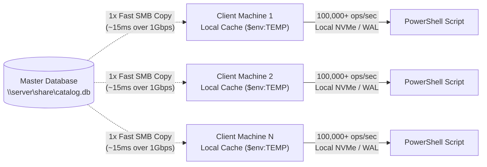

# PSLocalBase Documentation & Reference Guide

Welcome to the comprehensive **PSLocalBase** documentation guide! This document provides everything you need to know about embedded NoSQL document persistence in PowerShell, from a 2-minute quick start to advanced multi-collection sharding, relational joins, and multi-client SMB architecture.

---

## Table of Contents

- [Quick Start in 2 Minutes](#quick-start-in-2-minutes)
- [Visual Explorer: Interactive GUI Playground](#visual-explorer-interactive-gui-playground)
- [Single Collection vs Multi Collection: Feature Matrix](#single-collection-vs-multi-collection-feature-matrix)
- [1. Installation & Import](#1-installation--import)
- [2. Database Initialization](#2-database-initialization)
  - [Standard File-Based Persistence](#standard-file-based-persistence)
  - [In-Memory Ephemeral Database](#in-memory-ephemeral-database)
  - [Helper Cmdlet: `New-LocalBase`](#helper-cmdlet-new-localbase)
- [3. Collections & Document Lifecycle](#3-collections--document-lifecycle)
  - [Collection Navigation (`collection`)](#collection-navigation-collection)
  - [Listing Collections (`getCollections`, `listCollections`)](#listing-collections-getcollections-listcollections)
  - [Collection Existence Check (`collectionExists`)](#collection-existence-check-collectionexists)
  - [Explicit Collection Creation (`create`, `createCollection`)](#explicit-collection-creation-create-createcollection)
  - [Targeting Documents (`doc`)](#targeting-documents-doc)
  - [Insert with Custom Key (`set`)](#insert-with-custom-key-set)
  - [Insert with Auto-Generated GUID (`add`)](#insert-with-auto-generated-guid-add)
  - [Atomic Upsert (`upsert`)](#atomic-upsert-upsert)
  - [Bulk Insert Entire Collection](#bulk-insert-entire-collection)
  - [Partial Update / Deep Merge (`update`)](#partial-update--deep-merge-update)
  - [Atomic Array Mutations (`ArrayUnion`, `ArrayRemove`)](#atomic-array-mutations-arrayunion-arrayremove)
  - [Secondary Expression Indexes (`createIndex`, `dropIndex`)](#secondary-expression-indexes-createindex-dropindex)
  - [Storage Integrity & Validation (`validate`)](#storage-integrity--validation-validate)
  - [Deleting Documents & Dropping Collections (`delete`, `drop`)](#deleting-documents--dropping-collections-delete-drop)
- [4. Querying & Filtering](#4-querying--filtering)
  - [Point Lookups](#point-lookups)
  - [Collection-Wide Retrieval](#collection-wide-retrieval)
  - [First Matching Record (`first`)](#first-matching-record-first)
  - [O(1) Existence Verification (`exists`)](#o1-existence-verification-exists)
  - [Selective Field Projection (`select`)](#selective-field-projection-select)
  - [Distinct Values (`distinct`)](#distinct-values-distinct)
  - [Filtering with `where()`](#filtering-with-where)
  - [Array Membership & Intersection (`array-contains`, `array-contains-any`)](#array-membership--intersection-array-contains-array-contains-any)
  - [Array Length Filtering (`whereLength`, `length`)](#array-length-filtering-wherelength-length)
  - [Data Type Filtering (`whereType`, `type`)](#data-type-filtering-wheretype-type)
  - [Array Index Filtering](#array-index-filtering)
  - [Counting Records (`count`)](#counting-records-count)
  - [Mathematical Aggregations (`sum`, `avg`, `min`, `max`)](#mathematical-aggregations-sum-avg-min-max)
  - [Sorting & Pagination (`orderBy`, `skip`, `limit`)](#sorting--pagination-orderby-skip-limit)
  - [Exposing Primary Keys (`keys = $true`)](#exposing-primary-keys-keys--true)
- [5. Relational Lookups with `.populate()`](#5-relational-lookups-with-populate)
- [6. Compound Queries & Sharding (`union`, `unionAll`, `collectionGroup`)](#6-compound-queries--sharding-union-unionall-collectiongroup)
- [7. Raw Cross-Collection Queries (`query`)](#7-raw-cross-collection-queries-query)
- [8. Atomic ACID Transactions](#8-atomic-acid-transactions)
- [9. Production Best Practice: `try / finally`](#9-production-best-practice-try--finally)
- [10. PowerShell Pipeline Integration & Object Standard](#10-powershell-pipeline-integration--object-standard)
- [11. Multi-Client Reading & SMB / Network Shares](#11-multi-client-reading--smb--network-shares)
  - [Why SQLite WAL Mode Cannot Coordinate Over SMB](#why-sqlite-wal-mode-cannot-coordinate-over-smb)
  - [The Recommended Pattern: Staging / Local Snapshot](#the-recommended-pattern-staging--local-snapshot)
  - [Helper Pattern: `Open-LocalBaseFromSmb`](#helper-pattern-open-localbasefromsmb)
  - [Direct SMB PRAGMA Directives (Technical Reference)](#direct-smb-pragma-directives-technical-reference)

---

## Quick Start in 2 Minutes

Get up and running with embedded NoSQL persistence in PowerShell in under two minutes:

```powershell
Import-Module .\PSLocalBase.psd1 -Force

# 1. Initialize embedded database (creates file & parent folder if not present)
$db = [PSLocalBase]::new(".\mydata.db", @{
    cacheSizeMB = 16      # Warm memory cache (default: 16 MB)
    wal         = $true   # High-concurrency WAL mode (default: true)
    depth       = 20      # Max JSON serialization depth (default: 20)
})

# 2. Insert documents (point set with custom key or auto-generated GUID)
$db.collection("users").doc("usr-100").set(@{
    name       = "Carlos Martinez"
    role       = "Admin"
    department = "Engineering"
    active     = $true
    skills     = @("PowerShell", "SQLite", "Cloud")
})

# 3. Read back single document as native [PSCustomObject]
$user = $db.collection("users").doc("usr-100").get()
Write-Host "User: $($user.name) | Role: $($user.role) | Active: $($user.active)"

# 4. Query collection with filtering, ordering, and pipeline formatting
$admins = $db.collection("users").where("role", "=", "Admin").orderBy("name", "asc").get()
$admins | Format-Table name, department, role, active

# 5. Clean close to release file handles
$db.close()
```

---

## Visual Explorer: Interactive GUI Playground

Prefer a visual tool to explore documents, test queries, and generate PowerShell code with one click? Launch the built-in **WPF Playground**:

```powershell
pwsh -ExecutionPolicy Bypass -File .\Playground\Playground.ps1
# or
powershell.exe -ExecutionPolicy Bypass -File .\Playground\Playground.ps1
```

* **Interactive Query Builder:** Build and execute `.where()`, `.orderBy()`, `.limit()`, and `.count()` with immediate feedback.
* **Live PowerShell Code Snippets:** Copy generated PowerShell syntax directly to your clipboard.
* **Seed Demo Data:** 1-click loading of realistic users, products, and orders datasets.
* **Theme Switching:** Sleek dark and light themes with automatic Windows OS theme detection.

---

## Single Collection vs Multi Collection: Feature Matrix

| Capacidad / Función | Single Collection (`$col`) | Multi Collection (`collectionGroup`, `union`, `populate`) | Motor / Función SQLite Nativa | Retorno en PowerShell |
|---|:---:|:---:|---|:---:|
| **Búsqueda por ID (`.doc("id")`)** | ✅ Sí | ❌ No *(buscar por `.where("key", "==", "id")`)* | B-Tree Primary Key (`WHERE key = ?`) | `[PSCustomObject]` |
| **Proyección de Campos (`.select()`)** | ✅ Sí | ✅ Sí | `json_object()`, `json_extract()` | `[PSCustomObject[]]` |
| **Filtros Escalares (`.where()`)** | ✅ Sí | ✅ Sí | `json_extract()` | `[PSLocalBase]` (chainable) |
| **Pertenencia a Arrays (`array-contains`)** | ✅ Sí | ✅ Sí | `json_each()` | `[PSLocalBase]` (chainable) |
| **Intersección de Arrays (`array-contains-any`)** | ✅ Sí | ✅ Sí | `json_each()` | `[PSLocalBase]` (chainable) |
| **Longitud de Arrays (`whereLength`)** | ✅ Sí | ✅ Sí | `json_array_length()` | `[PSLocalBase]` (chainable) |
| **Tipado Polimórfico (`whereType`)** | ✅ Sí | ✅ Sí | `json_type()` | `[PSLocalBase]` (chainable) |
| **Indexación en Arrays (`items[0]`)** | ✅ Sí | ✅ Sí | `json_extract()` con path indexado | `[PSLocalBase]` (chainable) |
| **Valores Únicos (`.distinct()`)** | ✅ Sí | ✅ Sí | `json_extract()` + `SELECT DISTINCT` | `[object[]]` |
| **Ordenamiento (`.orderBy()`)** | ✅ Sí | ✅ Sí | `json_extract()` + `ORDER BY` | `[PSLocalBase]` (chainable) |
| **Paginación (`.skip()`, `.limit()`)** | ✅ Sí | ✅ Sí | `LIMIT ? OFFSET ?` | `[PSLocalBase]` (chainable) |
| **Agregaciones (`.sum()`, `.avg()`, `.min()`, `.max()`)** | ✅ Sí | ✅ Sí | `json_extract()` + Funciones Agregadas | `[double]` / `[object]` |
| **Conteo (`.count()`)** | ✅ Sí | ✅ Sí | `COUNT(*)` / B-Tree Page Scan | `[int64]` |
| **Verificación de Existencia (`.exists()`)** | ✅ Sí | ✅ Sí | `SELECT 1 ... LIMIT 1` ($O(1)$) | `[bool]` (`$true`/`$false`) |
| **Actualización Parcial (`.update()`)** | ✅ Sí | ❌ No *(solo tablas individuales)* | `json_patch()` (RFC 7396 Merge Patch) | `[void]` |
| **Mutaciones de Array (`ArrayUnion`, `ArrayRemove`)** | ✅ Sí | ❌ No *(solo tablas individuales)* | `json_set()`, `json_each()` | `[void]` |
| **Upsert Atómico (`.upsert()`)** | ✅ Sí | ❌ No *(solo tablas individuales)* | `INSERT ... ON CONFLICT DO UPDATE` | `[void]` |
| **Validación de Esquema (`.validate()`)** | ✅ Sí | ❌ No *(solo tablas individuales)* | `json_valid()` + `CHECK CONSTRAINT` | `[PSCustomObject]` |
| **Índices Secundarios (`.createIndex()`)** | ✅ Sí | ❌ No *(solo tablas individuales)* | `CREATE INDEX ... (json_extract(...))` | `[void]` |
| **Relaciones / Joins (`.populate()`)** | ❌ No | ✅ **Exclusivo** | `LEFT JOIN` + `json_set()` + `json()` | `[PSCustomObject[]]` |
| **Consultas Sharded (`.collectionGroup()`)** | ❌ No | ✅ **Exclusivo** | `UNION ALL` + `json_set()` metadata | `[PSCustomObject[]]` |
| **Uniones de Consultas (`.union()`, `.unionAll()`)** | ❌ No | ✅ **Exclusivo** | `UNION` / `UNION ALL` nativo | `[PSCustomObject[]]` |

---

## 1. Installation & Import

PSLocalBase requires **zero external dependencies**, no NuGet packages, and no binary downloads. It uses Windows' native, pre-installed SQLite engine (`winsqlite3.dll`).

```powershell
# Import the module manifest
Import-Module .\PSLocalBase.psd1 -Force
```

Compatible with:
* **Windows PowerShell 5.1** (Desktop Edition / .NET Framework 4.x)
* **PowerShell 7.x+** (Core Edition / .NET 6+) on Windows 10, Windows 11, Windows Server 2019+, and WinPE x64.

---

## 2. Database Initialization

### Standard File-Based Persistence
Creates or opens a SQLite database file on disk. Parent directories are created automatically if they do not exist.

```powershell
# Method A: Using the standard class constructor
$db = [PSLocalBase]::new(".\app_data.db")

# Method B: With performance & serialization tuning options
$db = [PSLocalBase]::new(".\app_data.db", @{
    cacheSizeMB = 32      # 32 MB warm page cache (default: 16)
    wal         = $true   # Write-Ahead Logging (default: true)
    depth       = 20      # JSON serialization depth limit (default: 20)
    busyTimeout = 5000    # Retry timeout on locks in ms (default: 5000)
})
```

### In-Memory Ephemeral Database
Lives exclusively in RAM with zero disk footprints. Ideal for testing, temporary caching, and CI/CD pipelines.

```powershell
$db = [PSLocalBase]::new(":memory:")
```

### Helper Cmdlet: `New-LocalBase`
You can also initialize instances using standard PowerShell cmdlet syntax:

```powershell
# In-memory
$db = New-LocalBase

# File-based
$db = New-LocalBase -Path "C:\Data\app.db"
```

---

## 3. Collections & Document Lifecycle

Collections map to isolated SQLite tables. Collection navigation is **lazy**: referencing a collection (`$db.collection("name")`) or querying it does not create ghost/empty tables until documents are written.

### Collection Navigation (`collection`)
```powershell
$col = $db.collection("orders")
```

### Listing Collections (`getCollections`, `listCollections`)
Returns an array of all collection names present in the active database:
```powershell
$names = $db.getCollections()
# Returns: @("users", "products", "orders")
```

### Collection Existence Check (`collectionExists`)
```powershell
if (-not $db.collectionExists("audit_logs")) {
    $db.createCollection("audit_logs")
}
```

### Explicit Collection Creation (`create`, `createCollection`)
Pre-provisions the collection table in SQLite immediately without requiring initial documents:
```powershell
# Fluent chaining:
$db.collection("audit_logs").create()

# Direct method:
$db.createCollection("audit_logs")
```

### Targeting Documents (`doc`)
Targets a document either by its unique string key or by an object/hashtable criteria:
```powershell
# By string key:
$db.collection("users").doc("usr-100")

# By criteria hashtable:
$db.collection("users").doc(@{ id = "usr-100" })
```

### Insert with Custom Key (`set`)
```powershell
$db.collection("users").doc("usr-100").set(@{
    name       = "Carlos Martinez"
    role       = "Lead Architect"
    active     = $true
    department = "Engineering"
    skills     = @("PowerShell", "SQLite", "Security")
})
```

### Insert with Auto-Generated GUID (`add`)
Generates a unique 32-character GUID key and returns it:
```powershell
$logId = $db.collection("audit_logs").add(@{
    action    = "UserLogin"
    userId    = "usr-100"
    timestamp = (Get-Date).ToString("o")
})
Write-Host "Created audit record with ID: $logId"
```

### Atomic Upsert (`upsert`)
Inserts the document if it does not exist, or updates it atomically if the key already exists (`INSERT ... ON CONFLICT(key) DO UPDATE`):
```powershell
# Upsert with explicit custom key:
$db.collection("devices").upsert(@{ serial = "SN-100"; status = "online" }, "dev-1")

# Upsert with criteria object:
$db.collection("devices").upsert(@{ id = "dev-1"; serial = "SN-100"; status = "online" })

# Or using fluent .doc() chaining:
$db.collection("devices").doc("dev-1").upsert(@{ serial = "SN-100"; status = "standby" })
```

### Bulk Insert Entire Collection
Atomically replaces the entire collection with an array of objects:
```powershell
$products = @(
    @{ id = "prod-1"; name = "Mechanical Keyboard"; price = 120.00; stock = 45 },
    @{ id = "prod-2"; name = "Wireless Mouse";     price = 45.50;  stock = 120 },
    @{ id = "prod-3"; name = "USB-C Hub";           price = 35.00;  stock = 80 }
)
$db.collection("products").set($products)
```

### Partial Update / Deep Merge (`update`)
Performs a deep recursive merge into the targeted document using SQLite's native `json_patch()`. Existing properties remain untouched:
```powershell
$db.collection("users").doc("usr-100").update(@{
    role    = "Principal Architect"
    profile = @{
        title = "Staff Fellow"
    }
})
```

### Atomic Array Mutations (`ArrayUnion`, `ArrayRemove`)
Atomically mutate arrays inside documents without reading-modifying-writing the whole document:

```powershell
# Add tags without duplicates
$db.collection("users").doc("usr-100").update(@{
    skills = [PSLocalBase]::ArrayUnion("C#", "Security")
})

# Remove elements from array
$db.collection("users").doc("usr-100").update(@{
    skills = [PSLocalBase]::ArrayRemove("Security")
})

# Descriptor syntax also supported
$db.collection("users").doc("usr-100").update(@{
    skills = @{ '$arrayUnion' = @("CloudArchitecture") }
})
```

### Secondary Expression Indexes (`createIndex`, `dropIndex`)
Create native B-Tree indexes on document JSON fields for sub-millisecond querying over millions of records:

```powershell
# Standard secondary expression index
$db.collection("users").createIndex("idx_users_role", "role")

# Unique constraint index (throws exception on duplicate values)
$db.collection("users").createIndex("idx_users_email", "email", $true)

# Drop an index cleanly
$db.collection("users").dropIndex("idx_users_role")
```

### Storage Integrity & Validation (`validate`)
Every collection table is created with a strict table-level constraint:
```sql
doc TEXT NOT NULL CHECK (json_valid(doc))
```
To run an instant health audit on any collection:
```powershell
$report = $db.collection("users").validate()
# Returns:
# collection       : users
# isValid          : True
# totalRecords     : 10000
# corruptedRecords : 0
```

### Deleting Documents & Dropping Collections (`delete`, `drop`)
```powershell
# Delete single targeted document
$db.collection("users").doc("usr-100").delete()

# Delete matching filtered documents
$db.collection("audit_logs").where("timestamp", "<", (Get-Date).AddDays(-30).ToString("o")).delete()

# Drop entire collection table
$db.collection("temporary_data").drop()
```

---

## 4. Querying & Filtering

### Point Lookups
```powershell
$user = $db.collection("users").doc("usr-100").get()
```

### Collection-Wide Retrieval
```powershell
$allUsers = $db.collection("users").get()
```

### First Matching Record (`first`)
Retrieves the first matching document or returns `$null` without buffering arrays:
```powershell
$admin = $db.collection("users").where("role", "==", "Admin").first()
```

### O(1) Existence Verification (`exists`)
Instantly checks if a record exists using `SELECT 1 ... LIMIT 1`:
```powershell
# Point lookup existence
if ($db.collection("users").doc("usr-100").exists()) {
    Write-Host "User exists!"
}

# Query existence
if ($db.collection("products").where("stock", "<=", 0).exists()) {
    Write-Host "Warning: Out-of-stock items detected."
}
```

### Selective Field Projection (`select`)
Extracts and builds smaller JSON objects directly inside SQLite's C engine, reducing memory overhead:
```powershell
$users = $db.collection("users").select("name", "department").get()
```

### Distinct Values (`distinct`)
Retrieves deduplicated unique values leveraging SQLite B-Tree index scans:
```powershell
$roles = $db.collection("users").distinct("role")
# Returns: @("Admin", "Developer", "Manager")
```

### Filtering with `where()`
Supports chained filtering pushed down directly to SQLite's `json_extract()`:

```powershell
# Numeric comparisons
$db.collection("products").where("price", "<=", 50.00).get()

# Equality
$db.collection("users").where("active", "==", $true).get()

# String wildcards (LIKE)
$db.collection("users").where("name", "LIKE", "%Martinez%").get()

# Set inclusion (IN)
$db.collection("users").where("role", "IN", @("Admin", "Lead Architect")).get()

# Set exclusion (not-in)
$db.collection("users").where("role", "not-in", @("Guest", "Disabled")).get()

# Nested dot paths
$db.collection("orders").where("shipping.address.city", "==", "Seattle").get()
```

### Array Membership & Intersection (`array-contains`, `array-contains-any`)
```powershell
# Check if array contains a specific item
$devs = $db.collection("users").where("skills", "array-contains", "PowerShell").get()

# Check if array intersects with a set of items
$specialists = $db.collection("users").where("skills", "array-contains-any", @("Security", "Cloud")).get()
```

### Array Length Filtering (`whereLength`, `length`)
Evaluates array size directly in C using SQLite's `json_array_length()`:
```powershell
# Dedicated fluent method
$db.collection("orders").whereLength("items", ">", 3).get()

# Operator syntax inside .where()
$db.collection("users").where("skills", "length", "==", 5).get()
```

### Data Type Filtering (`whereType`, `type`)
Inspects dynamic document schemas using SQLite's `json_type()` (`null`, `integer`, `real`, `text`, `array`, `object`):
```powershell
# Dedicated fluent method
$db.collection("events").whereType("metadata", "==", "object").get()

# Operator syntax inside .where()
$db.collection("metrics").where("value", "type", "integer").get()
```

### Array Index Filtering
Target specific array offsets using standard JSONPath indexing:
```powershell
$db.collection("orders").where("items[0].sku", "==", "KB-100").get()
```

### Counting Records (`count`)
```powershell
# Total collection count
$totalUsers = $db.collection("users").count()

# Filtered count
$adminCount = $db.collection("users").where("role", "==", "Admin").count()
```

### Mathematical Aggregations (`sum`, `avg`, `min`, `max`)
Performs calculations directly inside the native SQLite engine without bringing documents into PowerShell:
```powershell
$totalSales = $db.collection("orders").sum("totalAmount")
$averageAge = $db.collection("users").avg("age")
$cheapest   = $db.collection("products").min("price")
$latestDate = $db.collection("audit_logs").max("timestamp")
```

### Sorting & Pagination (`orderBy`, `skip`, `limit`)
```powershell
$pagedUsers = $db.collection("users") `
    .where("active", "==", $true) `
    .orderBy("name", "asc") `
    .skip(20) `
    .limit(10) `
    .get()
```

### Exposing Primary Keys (`keys = $true`)
```powershell
$records = $db.collection("users").get(@{ keys = $true })
foreach ($r in $records) {
    Write-Host "Key: $($r.key) | Data: $($r.data.name)"
}
```

---

## 5. Relational Lookups with `.populate()`

Resolve foreign keys and joins across collections in a single native SQLite query, completely eliminating N+1 loop queries:

```powershell
# Embed customer user document into the order object
$ordersWithCustomers = $db.collection("orders") `
    .populate("customerId", "users", "customer") `
    .get()

foreach ($order in $ordersWithCustomers) {
    Write-Host "Order: $($order.orderId) | Placed By: $($order.customer.name)"
}
```

---

## 6. Compound Queries & Sharding (`union`, `unionAll`, `collectionGroup`)

### Compound Queries (`union`, `unionAll`)
Merge results across multiple distinct collections into a unified query:
```powershell
$activeQuery = $db.collection("active_orders").where("total", ">", 100)
$archiveQuery = $db.collection("archived_orders").where("total", ">", 100)

# Deduplicated UNION
$allBigOrders = $activeQuery.union($archiveQuery).orderBy("total", "desc").get()

# High-speed UNION ALL (without deduplication)
$allOrders = $activeQuery.unionAll($archiveQuery).get()
```

### Sharded Querying (`collectionGroup`)
Query across multiple collections matching a wildcard pattern (e.g. date-sharded logs or region tables). Each returned object automatically includes an origin property `._collection`:
```powershell
$criticalErrors = $db.collectionGroup("logs_2026_*") `
    .where("level", "==", "CRITICAL") `
    .orderBy("timestamp", "desc") `
    .limit(50) `
    .get()

foreach ($err in $criticalErrors) {
    Write-Host "[$($err._collection)] $($err.timestamp): $($err.message)"
}
```

---

## 7. Raw Cross-Collection Queries (`query`)

Execute arbitrary SQL statements across collections when complex joins, CTEs, or custom SQLite JSON expressions are required:

```powershell
$sql = @"
SELECT 
    json_extract(o.doc, '$.orderId') AS orderId,
    json_extract(u.doc, '$.name') AS customerName,
    json_extract(o.doc, '$.total') AS total
FROM orders o
JOIN users u ON json_extract(o.doc, '$.customerId') = u.key
WHERE CAST(json_extract(o.doc, '$.total') AS REAL) > 100.0
ORDER BY total DESC;
"@

$results = $db.query($sql)
$results | Format-Table orderId, customerName, total
```

---

## 8. Atomic ACID Transactions

Wrap multi-document operations in high-performance atomic transactions:

```powershell
$db.beginTransaction()
try {
    $db.collection("accounts").doc("acc-1").update(@{ balance = 400 })
    $db.collection("accounts").doc("acc-2").update(@{ balance = 600 })
    $db.commit()
    Write-Host "Funds transferred successfully."
} catch {
    $db.rollback()
    Write-Warning "Transfer failed, rolling back changes: $_"
}
```

---

## 9. Production Best Practice: `try / finally`

Always encapsulate database operations in a `try / finally` block to guarantee immediate connection closure and file handle release:

```powershell
$db = [PSLocalBase]::new(".\production.db")
try {
    $db.collection("metrics").add(@{
        cpu  = (Get-CimInstance Win32_Processor).LoadPercentage
        date = (Get-Date).ToString("o")
    })
} finally {
    # Guaranteed cleanup: ensures file lock release even on unhandled exceptions
    $db.close()
}
```

### Deleting a Database Completely (`deleteDatabase`)
To delete the active SQLite database file and its associated WAL journal files (`-wal`, `-shm`), invoke `.deleteDatabase()` directly from the root database instance:
```powershell
$db = [PSLocalBase]::new(".\temporary.db")
$db.collection("cache").add(@{ token = "xyz" })
# Closes handle and deletes .\temporary.db, .\temporary.db-wal, .\temporary.db-shm
$db.deleteDatabase()
```

---

## 10. PowerShell Pipeline Integration & Object Standard

Every single query method in PSLocalBase (`get()`, `first()`, `select()`, `populate()`, `collectionGroup()`, `union()`) returns **100% native PowerShell `[PSCustomObject]` instances**.

No raw JSON strings, no custom dictionaries, and no manual conversion steps required:

```powershell
# 1. Filter and export directly to CSV
$db.collection("products").where("stock", ">", 0).get() |
    Select-Object id, name, price, stock |
    Export-Csv -Path ".\inventory.csv" -NoTypeInformation

# 2. Interactive Windows GridView
$db.collection("users").get() | Out-GridView -Title "Active Users Directory"

# 3. Pipeline grouping & sorting
$db.collectionGroup("logs_2026_*").get() |
    Group-Object _collection |
    Select-Object Name, Count
```

---

## 11. Multi-Client Reading & SMB / Network Shares

When deploying PowerShell tools, deployment frameworks (e.g., LiteDeploy), or enterprise reporting scripts across multiple machines, you may need dozens or hundreds of client machines to query a centralized catalog or configuration database hosted on a network share (`\\server\share\data.db`).

Understanding the relationship between SQLite, Write-Ahead Logging (WAL), and the SMB protocol is essential for rock-solid stability and high throughput.

### Why SQLite WAL Mode Cannot Coordinate Over SMB

PSLocalBase defaults to SQLite **Write-Ahead Logging (`WAL`)** mode for maximum local write concurrency and speed. However, SQLite WAL mode relies fundamentally on a shared-memory index file (`.db-shm`).

* In Windows, shared memory is implemented at the NT kernel level via memory-mapped files (`MapViewOfFile`).
* The SMB/CIFS protocol transports file data and byte-range locks across the network, but **operating system kernels cannot coordinate shared memory across separate physical machines**.
* If multiple computers attempt to connect to a WAL database directly over an SMB share, the local shared memory indices fall out of sync, causing immediate `SQLITE_IOERR_SHMSIZE`, byte-range lock contention, deadlocks, or database corruption.
* **Built-in Guard:** To protect your data, PSLocalBase actively detects and rejects UNC network paths (`\\server\share\...`) and network-mapped drives (`Z:\...`) when initialized in WAL mode.

---

### The Recommended Pattern: Staging / Local Snapshot

Because SQLite is an embedded engine designed for direct disk and memory access, the industry-standard pattern for multi-client read access over SMB is the **Staging / Local Snapshot Pattern**:



#### Why This Is Superior
1. **Zero Lock Contention:** The SMB file is only opened for a brief sequential read copy. It leaves **zero persistent file locks** on the file server, allowing infinite concurrent reader machines without `SQLITE_BUSY` errors.
2. **Extreme Performance:** Copying a 10 MB - 50 MB database over a standard 1 Gbps LAN takes roughly 10–50 ms. Once copied locally, all queries run against local NVMe/SSD at **100,000+ operations/second**, completely avoiding chatty network round-trips for every B-tree traversal.
3. **Smart Invalidation:** Clients compare the remote file's `LastWriteTimeUtc` and file size before copying. If the master database hasn't changed, the existing local snapshot is reused instantly with zero network transfer.
4. **Network Resilience:** If the network share drops momentarily while a script is executing complex queries, the local database remains fully functional and never crashes.

---

### Helper Pattern: `Open-LocalBaseFromSmb`

Here is a ready-to-use production helper function that you can incorporate into your deployment and administration scripts:

```powershell
function Open-LocalBaseFromSmb {
    [CmdletBinding()]
    param(
        [Parameter(Mandatory = $true)]
        [string]$SmbPath,

        [Parameter()]
        [switch]$CacheLocally,

        [Parameter()]
        [int]$CacheSizeMB = 32
    )

    if (-not (Test-Path -LiteralPath $SmbPath)) {
        throw [System.IO.FileNotFoundException]::new("Network database not found: '$SmbPath'")
    }

    # Generate a deterministic cache folder based on the share path hash
    $hasher = [System.Security.Cryptography.SHA256]::Create()
    $hashBytes = $hasher.ComputeHash([System.Text.Encoding]::UTF8.GetBytes($SmbPath.ToLower()))
    $pathHash = [BitConverter]::ToString($hashBytes).Replace("-", "").Substring(0, 12)
    
    $cacheDir = [System.IO.Path]::Combine($env:TEMP, "PSLocalBase_Cache", $pathHash)
    if (-not [System.IO.Directory]::Exists($cacheDir)) {
        [void][System.IO.Directory]::CreateDirectory($cacheDir)
    }

    $fileName = [System.IO.Path]::GetFileName($SmbPath)
    $localDbPath = [System.IO.Path]::Combine($cacheDir, $fileName)

    $remoteFile = Get-Item -LiteralPath $SmbPath
    $needsCopy = $true

    if ($CacheLocally -and [System.IO.File]::Exists($localDbPath)) {
        $localFile = Get-Item -LiteralPath $localDbPath
        # Reuse existing local snapshot if timestamps and sizes match
        if ($localFile.LastWriteTimeUtc -eq $remoteFile.LastWriteTimeUtc -and $localFile.Length -eq $remoteFile.Length) {
            $needsCopy = $false
        }
    }

    if ($needsCopy) {
        # Copy master snapshot with overwrite
        Copy-Item -LiteralPath $SmbPath -Destination $localDbPath -Force
        # Synchronize timestamp for future cache invalidation checks
        (Get-Item -LiteralPath $localDbPath).LastWriteTimeUtc = $remoteFile.LastWriteTimeUtc
    }

    # Open local copy with full WAL speed and enlarged RAM cache
    return [PSLocalBase]::new($localDbPath, @{
        wal         = $true
        cacheSizeMB = $CacheSizeMB
        busyTimeout = 5000
    })
}
```

#### Usage Example

```powershell
# Query central hardware inventory hosted on a network share
$db = Open-LocalBaseFromSmb -SmbPath "\\fileserver\deploy\inventory.db" -CacheLocally

try {
    # Instant, zero-latency local queries
    $servers = $db.collection("servers") `
        .where("datacenter", "==", "East-1") `
        .where("status", "==", "active") `
        .orderBy("hostname", "asc") `
        .get()

    $servers | Format-Table hostname, ip, rack, osVersion
} finally {
    $db.close()
}
```

---

### Direct SMB PRAGMA Directives (Technical Reference)

If your environment strictly prohibits copying files to local disk and requires clients to query an SQLite file directly across an SMB share, the database **cannot** use WAL mode. It must use rollback journal mode (`DELETE` or `OFF`) and the client connections must execute specific PRAGMA directives immediately upon opening:

```sql
PRAGMA journal_mode = DELETE;  -- Rollback journal instead of WAL; compatible with SMB byte-range locking
PRAGMA query_only = ON;        -- Prohibits all writes and schema alterations; guarantees read-only access
PRAGMA busy_timeout = 5000;    -- Waits up to 5,000ms on SMB oplock breaks before throwing SQLITE_BUSY
PRAGMA cache_size = -32768;    -- Reserves 32 MB client RAM cache to minimize chatty network round-trips
```

#### Detailed PRAGMA Breakdown

| PRAGMA Directive | Value | Purpose & Network Behavior |
|---|---|---|
| `PRAGMA journal_mode` | `DELETE` or `OFF` | **Mandatory on SMB.** Unlike WAL, standard rollback journals do not require kernel shared memory (`.db-shm`), making them functional across SMB shares. Setting to `OFF` eliminates journal file creation entirely for pure read-only sources. |
| `PRAGMA query_only` | `ON` | Instructs SQLite to reject any write operation at the SQL parser level. Prevents accidental write attempts, temporary table creations, or write lock escalations on the network share. |
| `PRAGMA busy_timeout` | `5000` (5s) | Network shares experience latency spikes and temporary file lock contention when multiple machines read the same database pages. Setting a 5,000ms timeout prevents premature `SQLITE_BUSY` exceptions by automatically retrying. |
| `PRAGMA cache_size` | `-32768` (32MB) | By default, SQLite only caches 2MB of pages in RAM. Negative values denote size in KiB (`-32768` = 32,768 KiB / 32 MB). Over high-latency network links, an enlarged client-side cache keeps index nodes and documents in RAM, drastically reducing SMB network round-trips. |

#### Architectural Trade-Off Matrix

| Feature | Staging / Local Snapshot Pattern | Direct SMB Read Connection |
|---|---|---|
| **Write-Ahead Logging (WAL)** | ✅ **Supported** (executes on local disk) | ❌ **Forbidden** (causes `SQLITE_IOERR`) |
| **Query Performance** | ⚡ **100,000+ ops/sec** (Local NVMe/RAM) | 🐢 **50–500 ops/sec** (SMB round-trip bound) |
| **Server Lock Contention** | 🟢 **Zero locks** on file server | ⚠️ Shared read locks held across network |
| **Offline / Network Resilience** | 🟢 Survives transient network disconnects | ❌ Crashes immediately on network drop |
| **Disk Footprint** | Requires temp disk space on client ($env:TEMP) | Zero local disk usage |
| **Recommended Usage** | ⭐ **Standard for all PowerShell automation** | Fallback for restricted thin clients |

---

## Related Documentation

* [Technical Architecture Specification](SPECIFICATION.md)
* [Performance Benchmarks (10k Records)](BENCHMARKS.md)
* [Interactive Benchmark Dashboard](benchmark-results.html)
* [Security Policy & Threat Model](../SECURITY.md)
* [Main Project README](../README.md)
