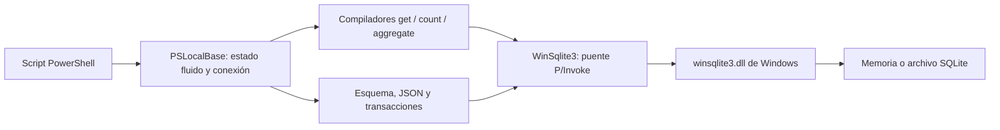

# Revisión independiente de seguridad, código, funcionalidad e issues

Fecha: 29 de octubre de 2026, America/New_York.

Revisión: `dev`, commit `d6f0bda9d98d10af550d59fe90e6286e11bb7fd0`. El motor y puente nativo son idénticos a `c57b52c17efe82a89b28ccee3c63fdd72922b4c5`. Se revisó el estado actual del proyecto, no solo el informe previo. No se modificaron el motor ni las pruebas existentes.

## Veredicto

El proyecto mejoró respecto a las primeras auditorías y las correcciones tienen efectos reales. Sin embargo, no recomiendo promoción general a producción sin reservas: quedan pérdidas de elementos numéricos, garantías UNIQUE incorrectas en casos reproducibles y combinaciones de consultas que cambian silenciosamente su alcance. La suite verde de CI no incluye todas las pruebas versionadas.

No encontré evidencia suficiente para atribuir manipulación intencional de pruebas. Sí confirmé omisiones, assertions débiles y una regresión de seguridad que no detecta el defecto que pretende vigilar. El badge 94/100 y la aprobación sin reservas no concuerdan con los resultados completos.

## Método y límites

- Agentes independientes revisaron arquitectura/datos e integridad de pruebas; el agente principal ejecutó y contrastó pruebas de seguridad, recursos y issues.
- CodeGraph se intentó inicializar y consultar antes de la exploración: falló por `npm-shim.js` ausente. Se recurrió a inspección directa.
- Se ejecutó el runner en procesos nuevos de PowerShell 7.6.9 y Windows PowerShell 5.1.26100.9767, además de Playground en STA.
- Se ejecutó por separado la suite independiente omitida por el runner y se añadieron reproducciones locales en `scratch/`, sin cambiar código productivo.
- Se usaron copias aisladas para introducir defectos deliberados y comprobar si las pruebas los detectaban. No se introdujeron esos defectos en el checkout.
- Las pruebas adversariales funcionales usaron bases en memoria. La suite original usa también archivos temporales. La prueba SMB creó solamente un directorio de prueba propio; no pudo crear el enlace simbólico por falta de privilegios.
- No se probaron fallos eléctricos, todos los Windows soportados, ARM64 ni WinPE. No se hizo una revisión de CVE del binario del sistema operativo. Una prueba de concurrencia en memoria no demuestra durabilidad WAL.

## Resultados ejecutados

| Comprobación | PowerShell 7 | Windows PowerShell 5.1 |
| --- | --- | --- |
| Suite original | 80 pasan | 80 pasan |
| Audit F01-F07 | 7 pasan | 7 pasan |
| Reevaluation R01-R08 y controles | 17 pasan | 17 pasan |
| NativeStress | Pasa | Pasa |
| Independent-c57b52c, excluida del runner | 2 pasan / **5 fallan**, exit 1 | 3 pasan / **4 fallan**, exit 1 |
| Reproducciones adicionales del agente de código | 9 fallos reproducidos | 8 fallos reproducidos |

Playground: pasan todas las comprobaciones automatizadas. Las reproducciones adicionales imprimen diagnósticos y no constituyen un runner de CI; no se infiere su éxito de un exit code cero. Varios casos adicionales coinciden con los de la suite independiente y no deben contarse como defectos distintos.

Las comprobaciones de recursos detectan cero statements vivos tras 500 ciclos de éxito/error; 100 bases cerradas con Dispose devuelven las asignaciones SQLite al nivel inicial. Dos escritores concurrentes preservan las 50 mutaciones, con reintentos explícitos del harness. Las conexiones abandonadas sin cierre retienen 4.453.920 bytes nativos tras GC en esta prueba de 20 bases: el cierre manual sigue siendo necesario. No se presenta esta observación como una fuga en el uso correctamente cerrado.

## Seguridad e integridad de las pruebas

1. **Suite versionada omitida.** `_TESTS/run-tests.ps1:7` enumera cuatro suites y excluye `PSLocalBase.Independent-c57b52c.Tests.ps1`, que falla en ambas ediciones. El informe previo la enumera entre sus suites en `_DOCS/AUDIT-CLAUDE-OPUS-5.5.md:572`. El resultado verde del runner no prueba que todas las pruebas del repositorio pasen.
2. **Runner permisivo ante ausencias.** `_TESTS/run-tests.ps1:16` omite archivos faltantes. Una copia del runner sin ninguna suite devuelve exit 0. Los archivos requeridos deben ser obligatorios.
3. **R03 no alcanza la ruta de quoting.** El nombre de índice de `_TESTS/PSLocalBase.Reevaluation.Tests.ps1:59` ya no coincide con el selector de índices actual. Reintroducir quoting inseguro en una copia del motor permite que R03 siga pasando. Un fixture que termina en `__email_A62F55FE`, y que sí es seleccionado, detecta el defecto del mutante. El motor real escapa correctamente las comillas y pasa ese fixture reforzado: aquí el defecto confirmado es de cobertura, no una SQLi vigente.
4. **Assertions permisivas.** R01a/R01b aceptarían un no-op silencioso además de una excepción; R08 acepta cualquier InvalidOperationException sin verificar el motivo. Esto no prueba mala intención, pero reduce la capacidad de detectar regresiones.
5. **No se debilitaron las 80 pruebas originales.** El diff revisado no elimina ni suaviza esas pruebas. Aumentar reintentos en el harness concurrente no equivale a que el motor reintente automáticamente: debe documentarse ese alcance.

Evidencia local: `scratch/current-test-review/check-r03.ps1`, `scratch/current-test-review/empty-runner/` y los logs del runner en `scratch/current-runner-ps7.log` y `scratch/current-runner-ps51.log`.

## Hallazgos actuales de código

### 1. P2 — Igualdad numérica todavía inexacta

`PSLocalBase.psm1:2255`, especialmente la conversión a Decimal en `:2262` y el fallback Double en `:2266`.

- PowerShell 7: guardar `1.0` y `1.0000000000000002`, después ejecutar ArrayRemove(1.0), elimina ambos valores.
- Ambas ediciones: guardar Int64 `9007199254740992` y eliminar Double `9007199254740992` conserva el elemento, pese a que ambos representan exactamente el mismo entero.

La conversión universal a Decimal no es una comparación exacta para todos los Double. Hace falta definir y aplicar igualdad numérica sin conversiones que redondeen. Los casos originales de Int64 adyacentes y UInt64 pasan; no cierran esta familia completa de fallos.

### 2. P2 — Colisión real de nombres de índice omite un UNIQUE

`PSLocalBase.psm1:323` conserva solo 32 bits del hash y `:339` confía en la identidad del nombre sin comprobar la expresión indexada.

Para la colección users, estas rutas distintas normalizan al mismo nombre y comparten hash `43CEB4E2`:

```text
a.a_a_a_a_a_a_a_a.a.a.a.a.a_a.a_a_a.a
a_a.a.a.a_a.a_a.a.a.a_a_a.a.a.a_a.a_a
```

Crear ambos índices UNIQUE deja un solo índice. Documentos con primera ruta diferente y segunda ruta igual son aceptados. Reproducido en ambas ediciones: no es únicamente una estimación probabilística.

Solución: identidad sin ambigüedad y comprobación de la expresión real del índice antes de asumir que el índice existente satisface la petición.

### 3. P2 — Eliminación ambigua de índices legacy

`PSLocalBase.psm1:384` y `:391`. El fallback `idx_users_profile_code` puede designar `profile.code` o `profile_code`. Crear un índice histórico UNIQUE sobre `$.profile_code` y llamar dropIndex('profile.code') elimina la restricción ajena y permite duplicados.

Solución: resolver los índices históricos por su definición, no exclusivamente por el nombre normalizado; rechazar una migración ambigua.

### 4. P2 — Cambio de unicidad no atómico

`PSLocalBase.psm1:346` elimina el índice anterior antes del CREATE de `:358`. Si hay duplicados y la creación UNIQUE falla, quedan cero índices en lugar de conservarse el índice anterior.

Solución: transacción o savepoint para todo el cambio de esquema, preservando también transacciones externas.

### 5. P2 — Agregados ignoran composiciones y paginación

`PSLocalBase.psm1:1636` y construcción del origen en `:1671`. Una unión cuyo get devuelve valores 10 y 20 produce sum=10; orderBy().limit(1).sum() devuelve 30 donde la fuente paginada contiene 10.

Solución: compartir la compilación del origen entre get/count/agregados, o rechazar expresamente combinaciones no soportadas. El caso puntual doc().sum() del hallazgo anterior sí quedó corregido.

### 6. P2 — Guardas incompletas de mutaciones compuestas

`PSLocalBase.psm1:794` permite collectionGroup('audit_*').add(), creando una tabla literal audit_*. union().createIndex() también modifica solamente la rama izquierda. Las guardas nuevas de set y delete sí funcionan.

Solución: validación común de capacidades para todos los terminales mutantes, previa a cualquier cambio de esquema o datos.

### 7. P2/P3 — Privacidad de diagnóstico más limitada de lo anunciado

`PSLocalBase.psm1:1890`, `:2204` y mensajes de error con SQL. Los literales de query y los filtros numéricos aparecen en logs; un error de preparación puede incluir un literal incluso con debug desactivado. Los valores enlazados como parámetros no se imprimen en la prueba de control.

Solución: omitir texto SQL sensible en diagnósticos por defecto, o documentar con precisión la limitación. No se encontró una inyección mediante los valores parametrizados ni mediante el nombre de índice correctamente escapado en la versión real.

### 8. Funcionalidad pendiente ya descrita en issues

Populate con union/unionAll/collectionGroup devuelve referencias string sin poblar; al añadir select falla con `no such column: m.doc` (#13). query convierte BLOB binarios a string y no preserva sus bytes (#17). Ambos están reproducidos en las dos ediciones.

Repros de código: `scratch/current-code-review/probes.ps1`, `scratch/issues-code-review/issues-13-17.ps1`, `scratch/issues-root/check-14-16.ps1` y la suite versionada `_TESTS/PSLocalBase.Independent-c57b52c.Tests.ps1`.

## Estado de correcciones previas

| Familia | Veredicto actual |
| --- | --- |
| F01 / R01: borrado ordenado y set/delete compuestos | Casos concretos corregidos; falta uniformidad en otros mutadores |
| F02: identidad upsert | Corregido en los casos verificados, incluidos GUIDs distintos y NUL |
| F03 / R04: igualdad numérica | Parcial: enteros originales pasan; quedan los casos numéricos descritos |
| F04 / R02 / R05: índices y mayúsculas | Casos modernos básicos pasan; quedan legacy, colisión real de hash y atomicidad |
| F05 / R07: doc en union y collectionGroup | Union puntual funciona; group.doc se rechaza antes de crear esquema |
| F06: parámetros de ramas ausentes | Corregido en get/count y controles compuestos ejecutados |
| F07: pertenencia exclusiva a arrays | Corregido en lectura y borrado de los casos comprobados |
| R03: quoting de índices | Corregido en el motor; prueba original insuficiente, fixture reforzado pasa |
| R06: booleanos de proyección | Corregido en los casos verificados |
| R08: agregado puntual | Corregido; agregado compuesto/paginado sigue pendiente |

## Revisión y acciones sobre issues abiertos

Se leyeron los nueve issues #13–#21. La petición final del propietario se refiere a issues, no a PR. No había PR abiertos; #12 ya estaba merged.

| Issue | Evidencia y viabilidad | Acción |
| --- | --- | --- |
| [#13](https://github.com/cmartineztech/PSLocalBase/issues/13) | Populate compuesto no se aplica; con select falla por alias. Viable compilar joins sobre subconsulta o rechazar combinación. | Mantener abierto |
| [#14](https://github.com/cmartineztech/PSLocalBase/issues/14) | Init pide WAL mediante Exec sin callback y no comprueba el modo devuelto. La omisión está confirmada por código; no se reprodujo un fallback silencioso de un archivo en este equipo. Viable leer y verificar journal_mode. | Mantener como endurecimiento, no como corrupción confirmada |
| [#15](https://github.com/cmartineztech/PSLocalBase/issues/15) | Bare delete elimina la tabla, aunque SECURITY exige drop explícito. Reproducido. Viable alinear contrato, documentación y pruebas. | Mantener abierto |
| [#16](https://github.com/cmartineztech/PSLocalBase/issues/16) | Literales aparecen en debug y errores; parámetros enlazados no. Viable mejorar diagnósticos o acotar garantía. | Mantener abierto |
| [#17](https://github.com/cmartineztech/PSLocalBase/issues/17) | BLOB de 4 bytes se convierte a string de longitud 2. Viable byte[] con copia nativa o rechazo explícito. | Mantener abierto |
| [#18](https://github.com/cmartineztech/PSLocalBase/issues/18) | Hipótesis plausible, reproducción bloqueada al crear enlace por privilegios. No se pudo abrir SQLite por el enlace. | **Cerrado not_planned**, con explicación; no declarado falso |
| [#19](https://github.com/cmartineztech/PSLocalBase/issues/19) | Informes de revisiones distintas y badge sin reservas conviven con pruebas versionadas fallidas. Viable publicar estado por SHA y matizar cierres de hallazgos. | Mantener abierto |
| [#20](https://github.com/cmartineztech/PSLocalBase/issues/20) | Benchmarks de una muestra, sin calentamiento/mediana; JSON reescrito por elemento; faltan CPU/storage/SQLite. Viable repetir y acotar comparación. No se demostró falsificación de resultados. | Mantener abierto |
| [#21](https://github.com/cmartineztech/PSLocalBase/issues/21) | CI windows-latest PS7/5 no prueba WinPE, ARM64, Windows antiguos ni SMB real. Viable matriz probado/soportado/no verificado y pruebas manuales/self-hosted. No demuestra incompatibilidad. | Mantener abierto |

El cierre #18 sigue la instrucción expresa de cerrar reportes no reproducibles. [Comentario de cierre con alcance y condición de reapertura](https://github.com/cmartineztech/PSLocalBase/issues/18#issuecomment-6502053883). No se elevó el proceso ni se cambiaron permisos del sistema.

## Arquitectura y ergonomía



Fortalezas: puente pequeño, dependencia del binario del sistema, parámetros para valores, separación de propietario e hijos, savepoints en bulk y liberación explícita de statements. API fluida accesible para PowerShell.

Debilidades: una clase mezcla conexión, esquema, serialización, compilación y estado mutable; los compiladores get/count/aggregate divergen. Las restricciones de composición se repiten de forma desigual. Los fallbacks Update-TypeData duplican código y complican sesiones calientes. IntPtr expuesto y ausencia de SafeHandle/finalizador dejan el cierre bajo responsabilidad estricta del consumidor.

Prioridades: representación común del origen de consulta; guardas centrales de capacidades; identidad de índices con definición comprobada; cambios DDL atómicos; igualdad numérica exacta. Después, reforzar tests y documentación. No hace falta reescribir todo el motor para resolver esos puntos.

## Condiciones antes de recomendar producción general

1. Integrar en CI todas las suites requeridas, fallar si falta alguna y corregir los fallos actualmente excluidos.
2. Reparar igualdad numérica e identidad/atomicidad de índices; añadir las reproducciones anteriores como regresiones.
3. Hacer explícitas las combinaciones soportadas de consultas y mutaciones; resolver #13 y agregados compuestos.
4. Corregir las afirmaciones de privacidad, alcance de soporte y aprobación sin reservas. Mantener claramente separadas observación, prueba y garantía.

## Puntuación final

Valoración técnica orientativa de esta revisión, no porcentaje de cobertura ni certificación. Media simple de las cinco categorías solicitadas originalmente:

| Categoría | Puntuación |
| --- | ---: |
| Seguridad y anti-inyección | 84/100 |
| Integridad de datos y concurrencia | 58/100 |
| Estabilidad y memoria | 82/100 |
| Compatibilidad PS 5.1 / PS 7 en Windows probado | 86/100 |
| Funcionalidad y ergonomía NoSQL | 70/100 |
| **General** | **76/100** |

Arquitectura y fiabilidad de la validación necesitan mejoras aunque la interfaz y las defensas básicas sean útiles. La nota general no sustituye el criterio de publicación: los fallos de integridad y la suite incompleta bloquean mi recomendación de producción general en esta revisión.
